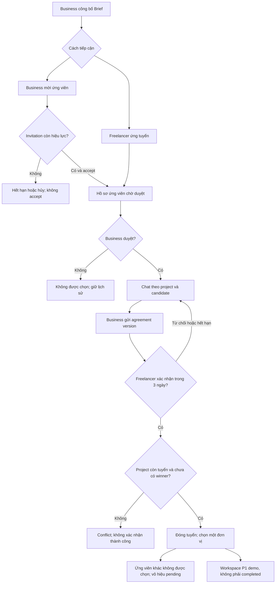
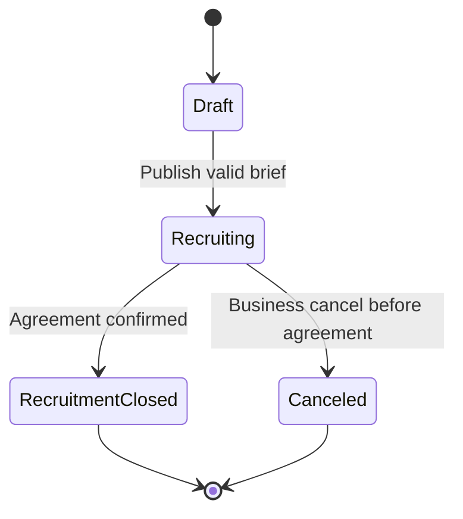

# FREVO — Main Flow & Full Product UI Scope v1

**Loại tài liệu:** Product/UI planning & prototype scope • **Ngày:** 17/10/2026 • **Bản:** Screen-Spec audit revision • **Nguồn chính:** `FREVO_SRS_Final.docx`, mục 1–11; **Nguồn chỉ dẫn:** prompt đính kèm. **Không phải bản cập nhật SRS.**

> **Quy ước nguồn:** **[SRS]** = xác nhận trực tiếp; **[Derived]** = diễn giải cần thiết và có căn cứ; **[UI proposal]** = đề xuất chưa phê duyệt; **[Decision]** = cần quyết định; **[Future]** = giai đoạn sau; **[Outside MVP]** = không thuộc P0. “Confirmed” ở screen inventory nghĩa là **có căn cứ để thiết kế UI**, không có nghĩa sản phẩm đã triển khai hoặc quy tắc P1/P2 đã được phê duyệt.

## 1. Executive summary & release definition

**[SRS, 1.2, 2.1–2.5]** FREVO kết nối Business nhỏ ở Việt Nam với Creative Freelancer cá nhân hoặc Team do một Freelancer đại diện. Vấn đề cốt lõi là đối chiếu Project Brief với bằng chứng năng lực, portfolio, phí và availability để Business ra quyết định; matching cung cấp lý do chứ không tự tuyển người. Hai cửa tuyển: Business mời hoặc Freelancer ứng tuyển, quy về **một candidate record cho một project × freelancer account**.
**[SRS] P0 kết thúc tại xác nhận Project Agreement và đóng tuyển.** “Đóng tuyển” khác “hoàn thành dự án”; chưa bao gồm thực hiện, nghiệm thu, tiền thật, review, admin. **[UI proposal] Release sắp tới** là prototype có điều hướng full-product screen coverage P0–P2, dùng mock dữ liệu và các tình huống trình diễn; **không** quảng bá giao dịch, AI thật, hợp đồng điện tử hoặc escrow.
**Definition of done:** mọi screen in-scope có ID/role/entry/action/state/FR; hai hướng tuyển hoạt động liền mạch tới agreement; P1/P2 nhìn thấy trong navigation hoặc demo branch đúng nhãn; tất cả fake AI/payment có disclosure; role guards, empty/loading/error được kiểm tra desktop/mobile; quyết định chưa chốt có log.
**Giả định:** landing đã có, được tái sử dụng; không có backend thật được cung cấp; dữ liệu demo giả định; Team leader là tài khoản thao tác duy nhất trong P0. **Rủi ro:** timeline ba tuần không đồng nghĩa implement fully interactive mọi màn hình.

## 2. Product scope & requirements analysis

SRS hiện có **63 FR** với ID định danh không liền mạch; không tạo FR cho số bỏ trống. Dòng “Trạng thái” như “Dự thảo”, “Đã chốt định hướng”, “Cần xác nhận” cần giữ riêng với P0/P1/P2.

| Requirement | Nội dung rút gọn (nguyên ý SRS)                                                                                                                                                                                                                                                                                                                                                                                                                                                                                                                                                                                                                                                                      | Actor                        | Priority | UI impact / screens                     | Trace status |
| ----------- | ---------------------------------------------------------------------------------------------------------------------------------------------------------------------------------------------------------------------------------------------------------------------------------------------------------------------------------------------------------------------------------------------------------------------------------------------------------------------------------------------------------------------------------------------------------------------------------------------------------------------------------------------------------------------------------------------------- | ---------------------------- | -------- | --------------------------------------- | ------------ |
| FR-001      | Cho phép đăng ký tài khoản Freelance hoặc Business( ghi nhận thêm tên cty hoặc cá cá nhân).                                                                                                                                                                                                                                                                                                                                                                                                                                                                                                                                                                                                          | Guest                        | P0       | AUTH-001                                | Mapped       |
| FR-002      | Cho phép đăng nhập và đăng xuất.                                                                                                                                                                                                                                                                                                                                                                                                                                                                                                                                                                                                                                                                     | Business, Freelancer         | P0       | AUTH-002                                | Mapped       |
| FR-003      | Cho phép người dùng cập nhật thông tin tài khoản hợp lệ.                                                                                                                                                                                                                                                                                                                                                                                                                                                                                                                                                                                                                                             | Business, Freelancer         | P0       | SET-001                                 | Mapped       |
| FR-004      | Giới hạn truy cập chức năng theo vai trò.                                                                                                                                                                                                                                                                                                                                                                                                                                                                                                                                                                                                                                                            | Hệ thống                     | P0       | SHARED-001                              | Mapped       |
| FR-005      | Cung cấp chức năng khôi phục mật khẩu.                                                                                                                                                                                                                                                                                                                                                                                                                                                                                                                                                                                                                                                               | Business, Freelancer         | P1       | AUTH-003                                | Mapped       |
| FR-006      | Tạo và chỉnh sửa hồ sơ nghề nghiệp.                                                                                                                                                                                                                                                                                                                                                                                                                                                                                                                                                                                                                                                                  | Freelancer                   | P0       | FL-002                                  | Mapped       |
| FR-007      | Quản lý kỹ năng và chuyên môn sáng tạo.                                                                                                                                                                                                                                                                                                                                                                                                                                                                                                                                                                                                                                                              | Freelancer                   | P0       | FL-002                                  | Mapped       |
| FR-008      | Thêm, sửa, xóa dự án trong portfolio Portfolio phải thể hiện thuộc cá nhân hay Team. Khi cá nhân sử dụng dự án đã thực hiện cùng Team, phải ghi rõ vai trò và phần đóng góp của mình.                                                                                                                                                                                                                                                                                                                                                                                                                                                                                                                | Freelancer                   | P0       | FL-003, FL-004, TEAM-003                | Mapped       |
| FR-010      | Hiển thị hồ sơ công khai được phép xem cho Business.                                                                                                                                                                                                                                                                                                                                                                                                                                                                                                                                                                                                                                                 | Business                     | P0       | BUS-008                                 | Mapped       |
| FR-011      | Cho phép tải lên CV tùy chọn để Business xem xét hồ sơ ứng viên.                                                                                                                                                                                                                                                                                                                                                                                                                                                                                                                                                                                                                                     | Freelancer                   | P0       | BUS-012, FL-005                         | Mapped       |
| FR-012      | Tạo Project Brief theo cấu trúc biểu mẫu.                                                                                                                                                                                                                                                                                                                                                                                                                                                                                                                                                                                                                                                            | Business                     | P0       | BUS-003                                 | Mapped       |
| FR-013      | Lưu Project Brief dưới dạng bản nháp.                                                                                                                                                                                                                                                                                                                                                                                                                                                                                                                                                                                                                                                                | Business                     | P0       | BUS-003                                 | Mapped       |
| FR-014      | Kiểm tra dữ liệu và công bố Project Brief hoàn chỉnh.                                                                                                                                                                                                                                                                                                                                                                                                                                                                                                                                                                                                                                                | Business                     | P0       | BUS-003, BUS-004                        | Mapped       |
| FR-015      | Xem danh sách dự án của mình cùng trạng thái.                                                                                                                                                                                                                                                                                                                                                                                                                                                                                                                                                                                                                                                        | Business                     | P0       | BUS-001, BUS-002, BUS-005               | Mapped       |
| FR-016      | Chủ dự án có thể chỉnh sửa hoặc đóng dự án.                                                                                                                                                                                                                                                                                                                                                                                                                                                                                                                                                                                                                                                          | Business                     | P0       | BUS-002, BUS-005, BUS-006               | Mapped       |
| FR-017      | Giải thích các yếu tố gợi ý như kỹ năng, ngân sách, thời gian đáp ứng và các tiêu chí đã dùng để xếp hạng.                                                                                                                                                                                                                                                                                                                                                                                                                                                                                                                                                                                           | Business                     | P0       | BUS-007, BUS-014                        | Mapped       |
| FR-018      | Business được mở hồ sơ cá nhân hoặc Team từ danh sách gợi ý để xem năng lực và portfolio được phép công khai.                                                                                                                                                                                                                                                                                                                                                                                                                                                                                                                                                                                        | Business                     | P0       | BUS-008                                 | Mapped       |
| FR-019      | Gửi lời mời tham gia dự án đã công bố cho Freelancer hoặc người đại diện Team đủ điều kiện; lời mời hết hạn sau 7 ngày. Gửi lời mời không tự động duyệt hồ sơ để mở chat.                                                                                                                                                                                                                                                                                                                                                                                                                                                                                                                            | Business                     | P0       | BUS-009, BUS-010                        | Mapped       |
| FR-020      | Cho phép Freelancer chấp nhận hoặc từ chối lời mời; nếu chấp nhận, hệ thống tạo/cập nhật một hồ sơ ứng viên ở trạng thái “Chờ Business xem xét”.                                                                                                                                                                                                                                                                                                                                                                                                                                                                                                                                                     | Freelancer                   | P0       | FL-010, FL-011                          | Mapped       |
| FR-021      | Hệ thống xếp hạng hồ sơ cá nhân/Team theo kỹ năng, kinh nghiệm và portfolio liên quan, mức phí dự kiến, trạng thái sẵn sàng và khả năng đáp ứng phạm vi dự án. Ưu tiên Cá nhân/Team chỉ hỗ trợ xếp hạng, không loại trừ loại còn lại.                                                                                                                                                                                                                                                                                                                                                                                                                                                                | Business                     | P0       | BUS-007                                 | Mapped       |
| FR-022      | Cho phép Business lọc danh sách gợi ý theo các tiêu chí phù hợp có trong Project Brief và hồ sơ.                                                                                                                                                                                                                                                                                                                                                                                                                                                                                                                                                                                                     | Business                     | P0       | BUS-007                                 | Mapped       |
| FR-023      | Hiển thị danh sách dự án đã công bố và còn nhận ứng tuyển.                                                                                                                                                                                                                                                                                                                                                                                                                                                                                                                                                                                                                                           | Freelancer                   | P0       | FL-006                                  | Mapped       |
| FR-024      | Tìm kiếm và lọc dự án.                                                                                                                                                                                                                                                                                                                                                                                                                                                                                                                                                                                                                                                                               | Freelancer                   | P0       | FL-006                                  | Mapped       |
| FR-025      | Xem chi tiết dự án và điều kiện ứng tuyển.                                                                                                                                                                                                                                                                                                                                                                                                                                                                                                                                                                                                                                                           | Freelancer                   | P0       | PUB-003, FL-007                         | Mapped       |
| FR-026      | Freelancer gửi proposal, portfolio liên quan và chọn hồ sơ ứng tuyển: cá nhân hoặc Team do mình đại diện. Tư cách ứng tuyển phải được hiển thị rõ cho Business.                                                                                                                                                                                                                                                                                                                                                                                                                                                                                                                                      | Freelancer                   | P0       | AUTH-004, FL-008, TEAM-004              | Mapped       |
| FR-027      | Theo dõi trạng thái ứng tuyển.                                                                                                                                                                                                                                                                                                                                                                                                                                                                                                                                                                                                                                                                       | Freelancer                   | P0       | FL-001, FL-009                          | Mapped       |
| FR-028      | Rút đơn ứng tuyển đang chờ xử lý.                                                                                                                                                                                                                                                                                                                                                                                                                                                                                                                                                                                                                                                                    | Freelancer                   | P1       | FL-009, FL-012                          | Mapped       |
| FR-029      | Xem các đơn ứng tuyển vào dự án do mình sở hữu.                                                                                                                                                                                                                                                                                                                                                                                                                                                                                                                                                                                                                                                      | Business                     | P0       | BUS-011, BUS-012                        | Mapped       |
| FR-030      | Xem lời mời đã gửi và trạng thái phản hồi.                                                                                                                                                                                                                                                                                                                                                                                                                                                                                                                                                                                                                                                           | Business                     | P0       | BUS-010                                 | Mapped       |
| FR-031      | Business xem xét hồ sơ ứng viên và chọn duyệt hoặc từ chối. Chỉ hồ sơ được duyệt mới mở hộp tin nhắn gắn với dự án; việc chấp nhận lời mời không thay thế bước duyệt này.                                                                                                                                                                                                                                                                                                                                                                                                                                                                                                                            | Business                     | P0       | BUS-011, BUS-012, BUS-013               | Mapped       |
| FR-032      | Business đề xuất bản tóm tắt thỏa thuận cho một ứng viên; đề xuất hết hạn sau 3 ngày và chỉ ghi nhận hợp tác khi ứng viên xác nhận nội dung còn hiệu lực.                                                                                                                                                                                                                                                                                                                                                                                                                                                                                                                                            | Business                     | P0       | PROJ-003, PROJ-004, PROJ-007            | Mapped       |
| FR-033      | Khi hai bên xác nhận thỏa thuận còn hiệu lực, hệ thống đóng tuyển, đánh dấu ứng viên được chọn và chuyển mọi hồ sơ còn lại sang “Không được chọn”; các lời mời/đề xuất đang chờ mất hiệu lực và các bên nhận thông báo. Đóng tuyển không đồng nghĩa dự án hoàn tất.                                                                                                                                                                                                                                                                                                                                                                                                                                  | Hệ thống                     | P0       | FL-013, PROJ-006                        | Mapped       |
| FR-034      | Hỗ trợ đối chiếu dữ liệu hồ sơ/CV/portfolio với yêu cầu dự án.                                                                                                                                                                                                                                                                                                                                                                                                                                                                                                                                                                                                                                       | Business                     | P1       | BUS-015                                 | Mapped       |
| FR-035      | Nêu điểm mạnh, khoảng thiếu và bằng chứng đối chiếu; tránh kết luận thiếu căn cứ.                                                                                                                                                                                                                                                                                                                                                                                                                                                                                                                                                                                                                    | Business                     | P1       | BUS-015                                 | Mapped       |
| FR-036      | Hiển thị rõ kết quả AI chỉ mang tính tư vấn, cần người xem xét.                                                                                                                                                                                                                                                                                                                                                                                                                                                                                                                                                                                                                                      | Business                     | P1       | BUS-015                                 | Mapped       |
| FR-037      | Tạo không gian quản lý dự án đã giao.                                                                                                                                                                                                                                                                                                                                                                                                                                                                                                                                                                                                                                                                | Business, Freelancer         | P1       | WORK-001                                | Mapped       |
| FR-038      | Hỗ trợ gửi sản phẩm bàn giao và phản hồi.                                                                                                                                                                                                                                                                                                                                                                                                                                                                                                                                                                                                                                                            | Business, Freelancer         | P1       | WORK-004                                | Mapped       |
| FR-039      | Hiển thị mốc công việc/deadline.                                                                                                                                                                                                                                                                                                                                                                                                                                                                                                                                                                                                                                                                     | Business, Freelancer         | P1       | WORK-002                                | Mapped       |
| FR-040      | Cho phép Business có quyền xác nhận hoàn thành dự án.                                                                                                                                                                                                                                                                                                                                                                                                                                                                                                                                                                                                                                                | Business                     | P1       | WORK-006                                | Mapped       |
| FR-041      | Đánh giá Freelancer sau dự án hoàn thành.                                                                                                                                                                                                                                                                                                                                                                                                                                                                                                                                                                                                                                                            | Business                     | P2       | REV-001                                 | Mapped       |
| FR-042      | Hiển thị lịch sử uy tín được phép công khai.                                                                                                                                                                                                                                                                                                                                                                                                                                                                                                                                                                                                                                                         | Business                     | P2       | REV-002                                 | Mapped       |
| FR-043      | Xem và quản lý tài khoản trong phạm vi phân quyền.                                                                                                                                                                                                                                                                                                                                                                                                                                                                                                                                                                                                                                                   | Admin                        | P2       | ADMIN-001, ADMIN-002                    | Mapped       |
| FR-044      | Kiểm duyệt nội dung bị báo cáo hoặc vi phạm chính sách.                                                                                                                                                                                                                                                                                                                                                                                                                                                                                                                                                                                                                                              | Admin                        | P2       | ADMIN-003, ADMIN-004                    | Mapped       |
| FR-045      | Chỉ mở hộp tin nhắn gắn với dự án sau khi Business duyệt hồ sơ ứng viên, dù hồ sơ phát sinh từ ứng tuyển hay lời mời đã được chấp nhận; Business và tài khoản Freelancer đại diện được xem.                                                                                                                                                                                                                                                                                                                                                                                                                                                                                                          | Business, Freelancer         | P0       | PROJ-001                                | Mapped       |
| FR-046      | Cho phép hai bên gửi/xem tin nhắn và ghi nhận người gửi, thời điểm gửi trong phạm vi được cấp quyền.                                                                                                                                                                                                                                                                                                                                                                                                                                                                                                                                                                                                 | Business, Freelancer         | P0       | PROJ-001                                | Mapped       |
| FR-047      | Business tạo và gửi bản tóm tắt thỏa thuận gồm phạm vi công việc, sản phẩm bàn giao, thời hạn và ngân sách. Freelancer có thể xác nhận hoặc từ chối. Bản tóm tắt ghi nhận nội dung hai bên thống nhất trên FREVO, không mặc định là hợp đồng điện tử.                                                                                                                                                                                                                                                                                                                                                                                                                                                | Business, Freelancer         | P0       | PROJ-003, PROJ-004                      | Mapped       |
| FR-048      | Khi nội dung bản tóm tắt thỏa thuận thay đổi sau khi đã được Freelancer xác nhận, Business phải tạo phiên bản đề xuất mới và gửi Freelancer xác nhận lại. Hệ thống lưu các phiên bản, người thay đổi và thời điểm xác nhận; phiên bản cũ tiếp tục là phiên bản có hiệu lực cho đến khi phiên bản mới được hai bên xác nhận. Nếu phiên bản mới bị từ chối hoặc hết hạn, phiên bản mới không có hiệu lực và hai bên có thể tiếp tục trao đổi. Không gọi thay đổi này là “phụ lục hợp đồng” trong phạm vi MVP.                                                                                                                                                                                          | Hệ thống                     | P0       | PROJ-005, PROJ-007                      | Mapped       |
| FR-049      | Hiển thị danh sách công việc/milestone và thời hạn của dự án đã giao.                                                                                                                                                                                                                                                                                                                                                                                                                                                                                                                                                                                                                                | Business, Freelancer         | P1       | WORK-002, WORK-003, WORK-008            | Mapped       |
| FR-050      | Freelancer có thể cập nhật tiến độ hoặc nộp liên kết/tệp bàn giao hợp lệ.                                                                                                                                                                                                                                                                                                                                                                                                                                                                                                                                                                                                                            | Freelancer                   | P1       | WORK-003, WORK-004, WORK-008            | Mapped       |
| FR-051      | Business có thể xem sản phẩm bàn giao và chọn chấp nhận hoặc yêu cầu chỉnh sửa kèm lý do.                                                                                                                                                                                                                                                                                                                                                                                                                                                                                                                                                                                                            | Business                     | P1       | WORK-005, WORK-008                      | Mapped       |
| FR-052      | Hệ thống lưu trạng thái, thời điểm và lịch sử phiên bản bàn giao để hai bên tra cứu.                                                                                                                                                                                                                                                                                                                                                                                                                                                                                                                                                                                                                 | Hệ thống                     | P1       | WORK-004, WORK-008                      | Mapped       |
| FR-053      | Chỉ đánh dấu dự án hoàn tất khi tất cả milestone đã được hoàn thành theo quy tắc nghiệm thu theo hợp đồng đã được define và xác nhận từ 2 bên                                                                                                                                                                                                                                                                                                                                                                                                                                                                                                                                                        | Hệ thống                     | P1       | WORK-006, WORK-008                      | Mapped       |
| FR-054      | Cho phép đánh giá sau khi hợp tác đã hoàn tất, theo tiêu chí và chính sách công bố đã chốt.                                                                                                                                                                                                                                                                                                                                                                                                                                                                                                                                                                                                          | Business, Freelancer         | P2       | REV-001                                 | Mapped       |
| FR-055      | Chỉ công khai phần đánh giá được phép hiển thị và có liên kết tới một hợp tác hợp lệ.                                                                                                                                                                                                                                                                                                                                                                                                                                                                                                                                                                                                                | Hệ thống                     | P2       | REV-002                                 | Mapped       |
| FR-056      | Business có thể thanh toán trước cho từng milestone đã được hai bên xác nhận thông qua đối tác thanh toán. Hệ thống hiển thị giá trị mốc, phí áp dụng và tổng tiền cần trả trước khi Business xác nhận. Không bắt buộc thanh toán toàn bộ dự án.                                                                                                                                                                                                                                                                                                                                                                                                                                                     | Business                     | P2       | PAY-001, PAY-002                        | Mapped       |
| FR-057      | FREVO xác thực kết quả thanh toán từ đối tác, đối chiếu đúng giao dịch, dự án và milestone. Thông báo lặp từ đối tác không được tạo thêm khoản thanh toán hoặc xử lý lại cùng giao dịch.                                                                                                                                                                                                                                                                                                                                                                                                                                                                                                             | Hệ thống                     | P2       | PAY-001                                 | Mapped       |
| FR-058      | Hai bên được xem số tiền và lịch sử giao dịch của từng milestone theo quyền truy cập. Hệ thống phân biệt rõ đã thanh toán cho mốc, đã nghiệm thu, đang giải ngân và đã giải ngân thành công; không ghi nhận thanh toán thành công chỉ dựa trên trang chuyển hướng của trình duyệt.                                                                                                                                                                                                                                                                                                                                                                                                                   | Business, Freelancer         | P2       | PAY-003, PAY-001                        | Mapped       |
| FR-059      | Hệ thống xử lý thanh toán thất bại, bị hủy, đang chờ hoặc chưa nhận được phản hồi từ đối tác. Cho phép kiểm tra lại trạng thái và thanh toán lại khi phù hợp, đồng thời ngăn ghi nhận hoặc thu tiền trùng. Milestone chưa được xác nhận thanh toán không được chuyển sang thực hiện.                                                                                                                                                                                                                                                                                                                                                                                                                 | Hệ thống                     | P2       | PAY-001, PAY-004                        | Mapped       |
| FR-060      | Sau khi milestone được nghiệm thu và không có tranh chấp đang ngăn giải ngân, hệ thống gửi yêu cầu giải ngân số tiền tương ứng cho Freelancer qua đối tác. Chỉ ghi nhận đã giải ngân khi có kết quả xác thực từ đối tác; lưu lịch sử và xử lý lỗi mà không giải ngân trùng.                                                                                                                                                                                                                                                                                                                                                                                                                          | Hệ thống, đối tác thanh toán | P2       | PAY-003                                 | Mapped       |
| FR-061      | FREVO không thu thập hoặc lưu số thẻ, CVV, mật khẩu thanh toán; dữ liệu nhạy cảm do đối tác thanh toán xử lý theo phương án tích hợp.                                                                                                                                                                                                                                                                                                                                                                                                                                                                                                                                                                | Hệ thống                     | P2       | PAY-002                                 | Mapped       |
| FR-062      | Hệ thống có thể cung cấp dữ liệu giao dịch, báo cáo và thông tin đối soát cần thiết để đáp ứng nghĩa vụ kế toán/thuế áp dụng cho các chủ thể liên quan.                                                                                                                                                                                                                                                                                                                                                                                                                                                                                                                                              | Hệ thống, Admin              | P2       | PAY-003                                 | Mapped       |
| FR-063      | Freelancer được quản lý hồ sơ cá nhân và hồ sơ Team do mình đại diện. Hồ sơ Team gồm tên, người đại diện, năng lực, thành viên và vai trò dự kiến, portfolio và trạng thái sẵn sàng. Trong MVP, tài khoản đại diện thực hiện các thao tác của Team; chưa có phân quyền riêng cho thành viên.                                                                                                                                                                                                                                                                                                                                                                                                         | Freelancer                   | P0       | AUTH-004, TEAM-001, TEAM-002, TEAM-003  | Mapped       |
| FR-064      | Hệ thống phải tạo và hiển thị thông báo trong ứng dụng cho các sự kiện: có đơn ứng tuyển mới; Freelancer nhận lời mời; lời mời được chấp nhận, từ chối, hủy hoặc hết hạn; hồ sơ ứng viên được duyệt hoặc bị từ chối; có tin nhắn mới trong cuộc trao đổi mà người dùng có quyền truy cập; có đề xuất thỏa thuận mới hoặc thay đổi trạng thái xác nhận. Thông báo phải liên kết tới đối tượng nghiệp vụ tương ứng khi người dùng có quyền truy cập. Email notification có thể được bật trong MVP cho các sự kiện quan trọng đã được xác định và cấu hình. Lỗi gửi email không được làm gián đoạn thao tác nghiệp vụ chính và không được tiết lộ thông tin riêng tư cho người không có quyền truy cập. | Business, Freelancer         | P0       | FL-010, NOTIF-001, NOTIF-002, NOTIF-003 | Mapped       |

**Yêu cầu xuyên màn hình:** BR-003/011/028 không tạo ứng viên/team gợi ý trùng; BR-012 bảo vệ CV; BR-013 kiểm soát chat; BR-023 tối đa một winner; BR-024 timeout; FR-064 event routing; NFR-01/02 responsive + accessible; NFR-04/05/10 security/media; NFR-06 giữ input; NFR-07 giải thích xếp hạng; NFR-08/09 integrity/audit. **Backend/nonvisual:** FR-057 webhook/reconcile, FR-061 không lưu dữ liệu thẻ, FR-062 accounting data, server authorization và audit; UI chỉ thể hiện trạng thái, không giả định tính năng nền tảng đã chạy.

## 3. Personas, roles, permissions & information needs

| Role                  | Goal & thông tin cần                                                   | Allowed                                                               | Not allowed / constraint                                    | Navigation                                               |
| --------------------- | ---------------------------------------------------------------------- | --------------------------------------------------------------------- | ----------------------------------------------------------- | -------------------------------------------------------- |
| Guest                 | Hiểu FREVO và xem dự án công khai                                      | Landing, browse project view-only, auth                               | Không apply/invite/chat                                     | Explore / Sign in                                        |
| Business              | Brief, năng lực, budget, portfolio, CV theo quyền, tình trạng ứng viên | Publish, invite, review & approve, chat sau duyệt, propose agreement  | Không apply như Freelancer, không truy cập CV ngoài phạm vi | Projects / Matching / Candidates / Messages / Agreements |
| Individual Freelancer | Khớp kỹ năng, budget, timeline, trạng thái phản hồi                    | Profile, portfolio, apply, invitation, chat sau duyệt, confirm/refuse | Không publish dự án, không tự mở chat                       | Explore projects / Applications / Invitations / Messages |
| Team representative   | Trình bày năng lực Team và tham gia dự án                              | Manage team profile and act as team via representative                | Thành viên không có account permissions riêng trong MVP     | Team profile / Applications / Invitations                |
| Admin [P2]            | Account/content moderation                                             | FR-043/044                                                            | Ngoài P0, permissions/detail policy chưa được chốt          | Admin area concept                                       |

| Hành động                        | Guest     | Business        | Individual / Team rep | Admin |
| -------------------------------- | --------- | --------------- | --------------------- | ----- |
| Publish project                  | —         | Own only        | —                     | —     |
| Browse projects                  | Read only | UI tùy thiết kế | Yes                   | TBD   |
| Manage freelancer/team portfolio | —         | Read public     | Own                   | TBD   |
| Send invitation                  | —         | Project owner   | Receive/respond       | —     |
| Apply                            | —         | —               | Yes                   | —     |
| Approve applicant                | —         | Project owner   | —                     | —     |
| Chat                             | —         | If approved     | If approved           | —     |
| Propose agreement                | —         | Project owner   | Confirm/refuse        | —     |
| Deliverable/review/payment       | —         | P1/P2 simulated | P1/P2 simulated       | —     |
| Moderate user/content            | —         | —               | —                     | P2    |

## 4. Information architecture & navigation

**[UI proposal]** Route hierarchy bên dưới là sitemap logic, không phải URL đã được SRS chốt:

```text
/public: Landing • Projects read-only • Project detail
/auth: Sign up • Sign in • Password recovery
/business: Dashboard • My Projects • Brief editor • Project detail
  /project/:id: Matching • Candidate inbox • Invitations • Candidate detail
  /project/:id: Chat per candidate • Agreement • Agreement versions
/freelancer: Dashboard • Individual profile • Portfolio/CV • Explore projects
  Applications • Invitations • Team profile (representative)
/shared: Notifications • Account settings • Access/error states
/assigned-project/:id: Workspace • Milestones • Deliverables • Acceptance [P1]
/payment/:id: Funding • Ledger • Failure • Dispute concept [P2 mock]
/reviews: Create review • Public reputation [P2]
/admin: Users • Account detail • Moderation queue/case [P2]
```

**Layouts:** Public shell giữ landing page hiện hữu; Business sidebar theo “Projects → Candidates → Messages”; Freelancer sidebar theo “Explore → Applications/Invitations → Profile”; Team dùng chính Freelancer shell với **context label**, không tạo role Team mới có account permission; Workspace subnav chia Overview/Milestones/Deliverables/Payment demo. Notification + account menu dùng chung. Route guard phải phản ánh quyền thật khi tích hợp backend.

## 5. Main user flows — bản rà soát đầy đủ theo SRS

> **Phân loại:** P0 là luồng nghiệp vụ MVP; P1/P2 là quy tắc giai đoạn sau hoặc mô phỏng/concept, tuyệt đối không coi là chức năng backend đã triển khai. `→` biểu thị điều hướng đề xuất, không đồng nghĩa tự động chuyển trạng thái.

### FLOW-01 — Đăng ký, đăng nhập và chọn ngữ cảnh

- **Actor:** Guest → Business/Freelancer. **Phạm vi:** P0.
- **Screen path / entry:** `PUB-001 → AUTH-001 → AUTH-002 → BUS-001 hoặc FL-001`.
- **Các bước và kết quả:** Chọn Business hay Freelancer; tạo tài khoản, xác thực đăng nhập và tải khu vực theo vai trò. Team không phải vai trò đăng nhập độc lập trong P0.
- **Decision, alternative, error & state guard:** Sai thông tin/đăng nhập thất bại: báo lỗi; chưa có quyền: SHARED-001. Quên mật khẩu AUTH-003 là P1.
- **Nguồn SRS:** FR-001–005; 2.3. **Open decisions:** Các chính sách chưa chốt được liệt kê ở mục 13; không mặc định giải quyết bởi mock.

### FLOW-02 — Business tạo, lưu nháp và công bố Brief

- **Actor:** Business. **Phạm vi:** P0.
- **Screen path / entry:** `BUS-001 → BUS-003 → BUS-004 → BUS-005`.
- **Các bước và kết quả:** Nhập tiêu đề, lĩnh vực, mô tả, skills, ngân sách, deadline, deliverables và trường tùy chọn; Save draft không công bố; Preview và validate trước Publish; chuyển Bản nháp → Đang tuyển.
- **Decision, alternative, error & state guard:** Thiếu trường bắt buộc hoặc deadline/budget không hợp lệ: giữ dữ liệu và hiển thị inline lỗi; Bản nháp không cho invite/apply.
- **Nguồn SRS:** FR-012–016; UC-01; BR-001/020; 11.8. **Open decisions:** Các chính sách chưa chốt được liệt kê ở mục 13; không mặc định giải quyết bởi mock.

### FLOW-03 — Business khám phá, matching và mời ứng viên

- **Actor:** Business. **Phạm vi:** P0.
- **Screen path / entry:** `BUS-005 → BUS-007 → BUS-008 → BUS-009 → BUS-010`.
- **Các bước và kết quả:** Lọc theo skill, experience, portfolio phù hợp, mức phí, availability, khả năng đáp ứng; thể hiện lý do xếp hạng, không cam kết AI; Individual/Team/Both là ưu tiên xếp hạng không loại trừ; xem evidence rồi gửi invitation 7 ngày.
- **Decision, alternative, error & state guard:** Không có ứng viên BUS-014; đã có invitation active cho cùng representative/project thì không tạo invitation active thứ hai; project đóng/hủy thì chặn.
- **Nguồn SRS:** FR-017–022; UC-02; BR-004/008/026–028. **Open decisions:** Các chính sách chưa chốt được liệt kê ở mục 13; không mặc định giải quyết bởi mock.

### FLOW-04 — Freelancer tạo hồ sơ cá nhân, portfolio, CV

- **Actor:** Freelancer. **Phạm vi:** P0.
- **Screen path / entry:** `FL-001 → FL-002 → FL-003 → FL-004 → FL-005`.
- **Các bước và kết quả:** Nhập nghề, skills, kinh nghiệm, rate, availability; thêm portfolio ảnh/video/link, đóng góp và quyền riêng tư; CV tùy chọn. Business chỉ xem CV khi có hồ sơ ứng tuyển hoặc lời mời được chấp nhận vào chính dự án của mình.
- **Decision, alternative, error & state guard:** Upload lỗi định dạng, MIME, kích thước, thời lượng: trạng thái rõ và không làm mất metadata; giới hạn 100 MB/2 phút chỉ là cấu hình đề xuất; chưa xác minh không gắn nhãn verified.
- **Nguồn SRS:** FR-006–011; BR-012/027; 11.2. **Open decisions:** Các chính sách chưa chốt được liệt kê ở mục 13; không mặc định giải quyết bởi mock.

### FLOW-05 — Team representative thiết lập và dùng hồ sơ Team

- **Actor:** Freelancer đại diện Team. **Phạm vi:** P0.
- **Screen path / entry:** `TEAM-001 → TEAM-002 → TEAM-003 → TEAM-004 → FL-008 hoặc FL-011`.
- **Các bước và kết quả:** Leader quản lý team profile, thông tin thành viên, kỹ năng, portfolio có attribution; chọn context Team khi apply, hoặc nhận invite nhắm tới đúng Team; matching đánh giá đúng team profile.
- **Decision, alternative, error & state guard:** Không cấp quyền thao tác độc lập cho thành viên; team không lặp trong một danh sách matching; cá nhân vẫn có thể được gợi ý riêng; chưa chốt member account liên kết ở giai đoạn sau.
- **Nguồn SRS:** FR-008/026/063; BR-002/003/027/028. **Open decisions:** Các chính sách chưa chốt được liệt kê ở mục 13; không mặc định giải quyết bởi mock.

### FLOW-06 — Freelancer tìm dự án và ứng tuyển chủ động

- **Actor:** Freelancer / Team leader. **Phạm vi:** P0.
- **Screen path / entry:** `FL-006 → FL-007 → AUTH-004 → FL-008 → FL-009`.
- **Các bước và kết quả:** Lọc Project Đang tuyển; xem brief; chọn tư cách Individual hay Team; soạn proposal, gắn portfolio evidence; submit tạo hồ sơ ứng viên Chờ Business xem xét; xem trạng thái.
- **Decision, alternative, error & state guard:** Dự án đóng/hủy hoặc dữ liệu không hợp lệ: chặn; một tài khoản chỉ một candidate record/dự án; nếu đã nhận lời mời thì gộp nguồn, không đổi tư cách đã ghi nhận.
- **Nguồn SRS:** FR-023–028; UC-03; BR-003/007/010/011/020. **Open decisions:** Các chính sách chưa chốt được liệt kê ở mục 13; không mặc định giải quyết bởi mock.

### FLOW-07 — Freelancer phản hồi lời mời

- **Actor:** Freelancer / Team leader. **Phạm vi:** P0.
- **Screen path / entry:** `NOTIF-001 hoặc FL-010 → FL-011 → FL-009`.
- **Các bước và kết quả:** Mở invitation cùng project/identity; Accept khi còn hiệu lực cập nhật cùng hồ sơ ứng viên sang Chờ Business xem xét; Decline ghi từ chối.
- **Decision, alternative, error & state guard:** Hết hạn sau 7 ngày hoặc invite hủy thì không accept; accept không mở chat, không tự chọn freelancer; project đã đóng tuyển cũng chặn.
- **Nguồn SRS:** FR-019/020; UC-04; BR-005/024. **Open decisions:** Các chính sách chưa chốt được liệt kê ở mục 13; không mặc định giải quyết bởi mock.

### FLOW-08 — Business xem xét và duyệt ứng viên

- **Actor:** Business. **Phạm vi:** P0.
- **Screen path / entry:** `BUS-005 → BUS-011 → BUS-012 → BUS-013 → PROJ-001 hoặc FL-013`.
- **Các bước và kết quả:** Inbox hợp nhất apply + accepted invitation theo một candidate record; xem proposal/portfolio/CV có quyền; Approve mở chat đúng project+candidate; Reject đưa sang Không được chọn và chặn chat tiếp.
- **Decision, alternative, error & state guard:** Không có hồ sơ BUS-014; CV không đủ quyền phải ẩn; reject không xóa lịch sử; không tự approve chỉ vì đã mời/chấp nhận mời.
- **Nguồn SRS:** FR-029–031/045; UC-05; BR-006/011–013; 11.4. **Open decisions:** Các chính sách chưa chốt được liệt kê ở mục 13; không mặc định giải quyết bởi mock.

### FLOW-09 — Trao đổi trong hộp chat theo ứng viên

- **Actor:** Business + candidate đã duyệt. **Phạm vi:** P0.
- **Screen path / entry:** `BUS-011 hoặc FL-009 → PROJ-001 ↔ PROJ-002`.
- **Các bước và kết quả:** Chỉ hai bên có quyền của project/candidate được đọc và gửi text; hiển thị sender, timestamp, pending và send-failed; nội dung chat không tự sửa agreement.
- **Decision, alternative, error & state guard:** Chưa duyệt: chat locked; hồ sơ bị từ chối/đã rút, dự án hủy hoặc đối thủ không được chọn sau đóng tuyển: không gửi tiếp, lịch sử vẫn bảo toàn theo quyền; file chat/read receipt chưa cam kết.
- **Nguồn SRS:** FR-045/046; BR-013; 11.6. **Open decisions:** Các chính sách chưa chốt được liệt kê ở mục 13; không mặc định giải quyết bởi mock.

### FLOW-10 — Business đề xuất thỏa thuận và Freelancer quyết định

- **Actor:** Business + Freelancer. **Phạm vi:** P0.
- **Screen path / entry:** `PROJ-001 → PROJ-003 → PROJ-004 → PROJ-006 hoặc PROJ-007`.
- **Các bước và kết quả:** Business soạn scope, deliverables, deadline, ngân sách, identity, conditions; gửi đề xuất version còn hiệu lực 3 ngày. Freelancer mở, đối chiếu và xác nhận hoặc từ chối. Chỉ accept thành công mới ghi nhận được chọn.
- **Decision, alternative, error & state guard:** Từ chối/hết hạn: không confirm phiên bản cũ; quay lại trao đổi hoặc đề xuất mới nếu còn tuyển; agreement không phải hợp đồng điện tử và không phải thanh toán/hoàn thành.
- **Nguồn SRS:** FR-032/033/047; UC-06; BR-015/022/024; 11.7. **Open decisions:** Các chính sách chưa chốt được liệt kê ở mục 13; không mặc định giải quyết bởi mock.

### FLOW-11 — Sửa đổi, versioning và đóng tuyển một ứng viên

- **Actor:** Business + Freelancer + System. **Phạm vi:** P0.
- **Screen path / entry:** `PROJ-003 → PROJ-005 → PROJ-004 → PROJ-006`.
- **Các bước và kết quả:** Nếu sửa sau xác nhận một phía, tạo version/Change Request, lưu diff, ai sửa và thời điểm; Freelancer xác nhận lại. Khi hai bên xác nhận version hợp lệ, project Đã đóng tuyển; selected giữ Đã được chọn, toàn bộ candidate khác Không được chọn; invitation/agreement pending vô hiệu.
- **Decision, alternative, error & state guard:** Từ chối revision quay lại trao đổi; quá hạn mở trạng thái PROJ-007; đồng thời hai confirmation phải kiểm tra one-winner atomically, loser thấy cập nhật trạng thái chứ không hiện thành công.
- **Nguồn SRS:** FR-033/048; BR-009/021/023/024; 11.7/11.8. **Open decisions:** Các chính sách chưa chốt được liệt kê ở mục 13; không mặc định giải quyết bởi mock.

### FLOW-12 — Rút ứng tuyển, hủy invitation, hủy dự án

- **Actor:** Freelancer / Business. **Phạm vi:** P0/P1.
- **Screen path / entry:** `FL-009 → FL-012; BUS-010 → BUS-010; BUS-005 → BUS-006`.
- **Các bước và kết quả:** Withdraw khi còn tuyển và chưa selected: Đã rút, lưu lịch sử/lý do tùy chọn; Business cancel invitation chỉ khi Chờ phản hồi; Business cancel project trước agreement hai phía: thu hồi pending, thông báo, lưu audit.
- **Decision, alternative, error & state guard:** Không xóa candidate/chat/audit; accepted invitation không thể "hủy" bằng cách xóa applicant; sau confirmed agreement không dùng cancel tuyển dụng để xóa nghĩa vụ; termination riêng chưa được duyệt.
- **Nguồn SRS:** FR-016/028; 11.4/11.8; BR-007/023. **Open decisions:** Các chính sách chưa chốt được liệt kê ở mục 13; không mặc định giải quyết bởi mock.

### FLOW-13 — Workspace và tiến độ milestone (demo)

- **Actor:** Business + Freelancer selected. **Phạm vi:** P1 simulation.
- **Screen path / entry:** `PROJ-006 → WORK-001 → WORK-002 → WORK-003`.
- **Các bước và kết quả:** Sau closed recruitment demo mở workspace P1; đề xuất một agreement chứa nhiều milestone với deliverables, criteria, deadline, amount, revisions. Hiển thị timeline, overdue, tiến độ; chuẩn bị funding riêng theo milestone.
- **Decision, alternative, error & state guard:** Ngoài P0; không suy diễn đã bắt đầu công việc chỉ vì đóng tuyển; scope change → WORK-007 và hai bên xác nhận; overdue → WORK-008.
- **Nguồn SRS:** UC-07; FR-037/039/049; BR-025; 10.2. **Open decisions:** Các chính sách chưa chốt được liệt kê ở mục 13; không mặc định giải quyết bởi mock.

### FLOW-14 — Gửi sản phẩm và nghiệm thu / yêu cầu chỉnh sửa

- **Actor:** Freelancer selected → Business. **Phạm vi:** P1 simulation.
- **Screen path / entry:** `WORK-003 → WORK-004 → WORK-005 → WORK-003 hoặc WORK-006`.
- **Các bước và kết quả:** Freelancer nộp deliverables theo milestone/version; Business đối chiếu tiêu chí đã thống nhất và Accept hoặc Request revision có lý do + tiêu chí chưa đạt; lưu lịch sử. Chỉ hoàn tất dự án nếu tất cả milestone được nghiệm thu theo quy tắc.
- **Decision, alternative, error & state guard:** Đầu ra thiếu, quá hạn, chỉnh sửa vượt số vòng, yêu cầu ngoài scope → trạng thái hoặc WORK-007; tranh chấp/chính sách auto-accept còn Needs decision, không tự quyết định.
- **Nguồn SRS:** UC-07/08; FR-038–040/050–053; BR-014/025; 10.4. **Open decisions:** Các chính sách chưa chốt được liệt kê ở mục 13; không mặc định giải quyết bởi mock.

### FLOW-15 — Funding theo milestone, trạng thái đối tác thanh toán (demo)

- **Actor:** Business + Freelancer. **Phạm vi:** P2 simulation.
- **Screen path / entry:** `WORK-002 → PAY-001 → PAY-002 → PAY-004 hoặc PAY-003`.
- **Các bước và kết quả:** Mỗi milestone cần funding được xác nhận trước In Progress; mặc định không yêu cầu Business nạp toàn bộ project. UI mô phỏng amount, fees TBD, simulated pending/success/failure, funding history; cập nhật khi trạng thái được xác nhận tương ứng môi trường.
- **Decision, alternative, error & state guard:** Thanh toán pending/failed/cancelled không phải paid; production cần provider confirmed với đối soát transaction/project/milestone/amount/currency; không lưu card data; tuyệt đối không dùng từ escrow thật cho demo.
- **Nguồn SRS:** FR-056–059/061/062; BR-017–019/025; 11.5. **Open decisions:** Các chính sách chưa chốt được liệt kê ở mục 13; không mặc định giải quyết bởi mock.

### FLOW-16 — Giải ngân, refund và tranh chấp (concept)

- **Actor:** Business + Freelancer; policy TBD. **Phạm vi:** P2 concept.
- **Screen path / entry:** `WORK-005 → PAY-003 hoặc PAY-005`.
- **Các bước và kết quả:** Accepted milestone và không bị dispute chặn mới có thể mô phỏng release. Dispute liên quan milestone A không khóa mặc định milestone B. Trường hợp không đạt nên ưu tiên revisions trong scope; ngoài scope → change request.
- **Decision, alternative, error & state guard:** Không tự động hoàn tiền hay giải ngân khi dispute chưa giải quyết; partial/full refund, evidence, appeal, fee, quyền phán quyết đều chưa chốt. PAY-005 là concept/visual-only, không có real dispute adjudication.
- **Nguồn SRS:** FR-060; BR-025; 10.5; 11.5. **Open decisions:** Các chính sách chưa chốt được liệt kê ở mục 13; không mặc định giải quyết bởi mock.

### FLOW-17 — Đánh giá và uy tín sau hoàn thành (demo)

- **Actor:** Business + Freelancer. **Phạm vi:** P2 concept.
- **Screen path / entry:** `WORK-006 → REV-001 → REV-002`.
- **Các bước và kết quả:** Chỉ minh họa eligibility sau project completed; Business đánh giá, reputation chỉ công khai theo policy được chốt. Hệ thống cần phân biệt sample review và review thật.
- **Decision, alternative, error & state guard:** Chưa đạt điều kiện thì disable; chính sách bên được đánh giá, quyền hai chiều, moderation và thời hạn chưa đầy đủ → Needs decision.
- **Nguồn SRS:** FR-041/042/054/055; UC-09; BR-016. **Open decisions:** Các chính sách chưa chốt được liệt kê ở mục 13; không mặc định giải quyết bởi mock.

### FLOW-18 — Notification và deeplink hợp lệ

- **Actor:** Business + Freelancer. **Phạm vi:** P0.
- **Screen path / entry:** `NOTIF-002 → NOTIF-001 → màn hình liên quan`.
- **Các bước và kết quả:** Gửi in-app cho new application, invitation response/expiry, applicant approval/reject, new chat, new or changed agreement, agreement response/expiry, closed/cancelled project; đánh dấu read/unread, liên kết đối tượng được phép xem.
- **Decision, alternative, error & state guard:** Link hết quyền → SHARED-001; email optional, lỗi email không rollback nghiệp vụ; tránh lộ CV/nội dung nhạy cảm qua email.
- **Nguồn SRS:** FR-064; 11.3. **Open decisions:** Các chính sách chưa chốt được liệt kê ở mục 13; không mặc định giải quyết bởi mock.

### FLOW-19 — Admin user management & content moderation (UI only)

- **Actor:** Admin. **Phạm vi:** P2 concept.
- **Screen path / entry:** `ADMIN-001 → ADMIN-002 hoặc ADMIN-003 → ADMIN-004`.
- **Các bước và kết quả:** UI mô tả quyền xem/quản lý tài khoản và báo cáo nội dung theo FR-043/044, có phân quyền Admin demo; không thiết kế thay workflow pháp lý/chính sách moderation chưa có.
- **Decision, alternative, error & state guard:** Không giả vờ thực hiện bans, appeal hoặc xử lý tranh chấp thật; các quyết định chi tiết là Need decision.
- **Nguồn SRS:** FR-043/044; 3.9. **Open decisions:** Các chính sách chưa chốt được liệt kê ở mục 13; không mặc định giải quyết bởi mock.

### FLOW-20 — Các trạng thái ngoại lệ giao diện

- **Actor:** All roles. **Phạm vi:** Cross-cutting.
- **Screen path / entry:** `SHARED-001 / SHARED-002 / SHARED-003; BUS-014; FL-013; PROJ-002/007; WORK-008; PAY-004`.
- **Các bước và kết quả:** Với từng source context, hiển thị nguyên nhân, action được phép (back, retry, edit, reopen if permitted), bảo toàn form input; thể hiện loading, empty, forbidden, expired, already selected, conflict và request failed.
- **Decision, alternative, error & state guard:** Không cho retry state-changing action một cách gây duplicate; trạng thái expired không thể thao tác trên bản cũ; cần kiểm tra server khi triển khai.
- **Nguồn SRS:** FR-004; BR-004/007/023/024; NFR; 11.8. **Open decisions:** Các chính sách chưa chốt được liệt kê ở mục 13; không mặc định giải quyết bởi mock.

### Sơ đồ tuyển chọn P0 hợp nhất



**Bất biến phải kiểm thử:** Một tài khoản/Project có một hồ sơ ứng viên; accept invitation không duyệt; duyệt mới mở chat; confirm agreement mới chọn; đóng tuyển không hoàn tất; một project chỉ một winner.

## 6. Complete screen inventory

**Interaction level** trong inventory: `Frontend-functional` = local form/validation; `Mock-interactive` = mock state transitions; `Visual-only` = presentation/navigation. Priority giữ mức FR chính; màn hình Derived/Proposed có mức phục vụ prototype được chọn, không biến thành yêu cầu SRS.

| ID         | Screen name                                     | Role                               | Area                      | Type        | P   | Scope        | Interaction         | Source                       |
| ---------- | ----------------------------------------------- | ---------------------------------- | ------------------------- | ----------- | --- | ------------ | ------------------- | ---------------------------- |
| PUB-001    | Landing / giới thiệu FREVO                      | Guest                              | Public                    | Page        | P0  | Confirmed    | Visual-only         | 2.3; 7.1                     |
| PUB-002    | Khám phá Project công khai (read-only)          | Guest                              | Public                    | Page        | P0  | Confirmed    | Mock-interactive    | 2.3; 2.1                     |
| PUB-003    | Chi tiết Project công khai                      | Guest                              | Public                    | Page        | P0  | Derived      | Mock-interactive    | 2.3; FR-025                  |
| AUTH-001   | Đăng ký và chọn vai trò                         | Guest/Business/Freelancer          | Account                   | Page        | P0  | Confirmed    | Frontend-functional | FR-001                       |
| AUTH-002   | Đăng nhập                                       | Guest/Business/Freelancer          | Account                   | Page        | P0  | Confirmed    | Frontend-functional | FR-002                       |
| AUTH-003   | Quên/đặt lại mật khẩu                           | Guest/Business/Freelancer          | Account                   | Page        | P1  | Confirmed    | Mock-interactive    | FR-005                       |
| AUTH-004   | Chọn hồ sơ hành động Individual/Team            | Guest/Business/Freelancer          | Account                   | Modal       | P0  | Derived      | Mock-interactive    | FR-026; FR-063; BR-003       |
| SET-001    | Thông tin tài khoản                             | Guest/Business/Freelancer          | Account                   | Page        | P0  | Confirmed    | Frontend-functional | FR-003                       |
| SET-002    | Privacy và giới hạn chia sẻ hồ sơ               | Guest/Business/Freelancer          | Account                   | Page        | P1  | Proposed     | Mock-interactive    | 3.2; NFR-05; 11.2            |
| SHARED-001 | 403 / Không có quyền truy cập                   | Guest/Business/Freelancer          | Account                   | State       | P0  | Derived      | Mock-interactive    | FR-004; NFR-04; NFR-05       |
| SHARED-002 | 404 / Không tìm thấy hoặc đã đóng               | Guest/Business/Freelancer          | Account                   | State       | P0  | Proposed     | Mock-interactive    | NFR-06; BR-007               |
| SHARED-003 | Lỗi mạng / retry / loading tổng quát            | Guest/Business/Freelancer          | Account                   | State       | P0  | Derived      | Mock-interactive    | NFR-06; 11.9                 |
| BUS-001    | Dashboard Business                              | Business                           | Business                  | Page        | P0  | Proposed     | Mock-interactive    | 7.1; FR-015                  |
| BUS-002    | Danh sách dự án của tôi                         | Business                           | Business                  | Page        | P0  | Confirmed    | Mock-interactive    | FR-015; FR-016               |
| BUS-003    | Tạo / sửa Structured Project Brief              | Business                           | Business                  | Page        | P0  | Confirmed    | Frontend-functional | FR-012–FR-014; UC-01         |
| BUS-004    | Xem trước / kiểm tra / công bố Brief            | Business                           | Business                  | Wizard step | P0  | Derived      | Mock-interactive    | FR-014; UC-01                |
| BUS-005    | Chi tiết dự án Business                         | Business                           | Business                  | Page        | P0  | Derived      | Mock-interactive    | FR-015; FR-016               |
| BUS-006    | Đóng tuyển hoặc hủy dự án                       | Business                           | Business                  | Modal       | P0  | Confirmed    | Mock-interactive    | FR-016; 11.4; 11.8           |
| BUS-007    | Danh sách matching và bộ lọc                    | Business                           | Business                  | Page        | P0  | Confirmed    | Mock-interactive    | FR-017; FR-021; FR-022; 11.1 |
| BUS-008    | Chi tiết năng lực ứng viên / evidence           | Business                           | Business                  | Page        | P0  | Confirmed    | Mock-interactive    | FR-018; FR-010; BR-012       |
| BUS-009    | Xác nhận gửi lời mời                            | Business                           | Business                  | Modal       | P0  | Derived      | Mock-interactive    | FR-019; UC-02                |
| BUS-010    | Lời mời đã gửi và trạng thái                    | Business                           | Business                  | Page        | P0  | Confirmed    | Mock-interactive    | FR-030; FR-019               |
| BUS-011    | Ứng viên theo dự án (inbox chung)               | Business                           | Business                  | Page        | P0  | Confirmed    | Mock-interactive    | FR-029; FR-031; BR-011       |
| BUS-012    | Review proposal + CV theo quyền                 | Business                           | Business                  | Page        | P0  | Derived      | Mock-interactive    | FR-029; FR-031; FR-011       |
| BUS-013    | Duyệt / từ chối ứng viên                        | Business                           | Business                  | Modal       | P0  | Derived      | Mock-interactive    | FR-031; UC-05                |
| BUS-014    | Ứng viên trống / không matching                 | Business                           | Business                  | State       | P0  | Derived      | Mock-interactive    | UC-02; FR-017                |
| BUS-015    | Candidate fit analysis (future AI)              | Business                           | Business                  | Drawer      | P1  | Confirmed    | Visual-only         | FR-034–FR-036                |
| FL-001     | Dashboard Freelancer                            | Freelancer                         | Freelancer                | Page        | P0  | Proposed     | Mock-interactive    | 7.1; FR-027                  |
| FL-002     | Hồ sơ nghề nghiệp cá nhân                       | Freelancer                         | Freelancer                | Page        | P0  | Confirmed    | Frontend-functional | FR-006; FR-007               |
| FL-003     | Quản lý portfolio                               | Freelancer                         | Freelancer                | Page        | P0  | Confirmed    | Mock-interactive    | FR-008; 10.1; 11.2           |
| FL-004     | Portfolio item editor / media upload            | Freelancer                         | Freelancer                | Modal       | P0  | Derived      | Mock-interactive    | FR-008; NFR-10; 11.2         |
| FL-005     | Quản lý CV tùy chọn                             | Freelancer                         | Freelancer                | Page        | P0  | Derived      | Mock-interactive    | FR-011; BR-012               |
| FL-006     | Tìm và lọc Project                              | Freelancer                         | Freelancer                | Page        | P0  | Confirmed    | Mock-interactive    | FR-023; FR-024               |
| FL-007     | Chi tiết dự án & điều kiện                      | Freelancer                         | Freelancer                | Page        | P0  | Confirmed    | Mock-interactive    | FR-025                       |
| FL-008     | Gửi proposal/ứng tuyển                          | Freelancer                         | Freelancer                | Page        | P0  | Confirmed    | Mock-interactive    | FR-026; BR-003               |
| FL-009     | Theo dõi đơn ứng tuyển                          | Freelancer                         | Freelancer                | Page        | P0  | Confirmed    | Mock-interactive    | FR-027; FR-028; 11.4         |
| FL-010     | Hộp thư lời mời                                 | Freelancer                         | Freelancer                | Page        | P0  | Confirmed    | Mock-interactive    | FR-020; FR-064               |
| FL-011     | Chi tiết và phản hồi lời mời                    | Freelancer                         | Freelancer                | Modal       | P0  | Derived      | Mock-interactive    | FR-020; BR-005               |
| FL-012     | Xác nhận rút ứng tuyển                          | Freelancer                         | Freelancer                | Modal       | P1  | Confirmed    | Mock-interactive    | FR-028; 11.4                 |
| FL-013     | Trạng thái không được chọn / hết hiệu lực       | Freelancer                         | Freelancer                | State       | P0  | Derived      | Mock-interactive    | FR-033; BR-023               |
| TEAM-001   | Hồ sơ Team                                      | Representative Freelancer          | Team                      | Page        | P0  | Confirmed    | Frontend-functional | FR-063; BR-027               |
| TEAM-002   | Danh sách thành viên và vai trò hiển thị        | Representative Freelancer          | Team                      | Tab         | P0  | Confirmed    | Mock-interactive    | FR-063                       |
| TEAM-003   | Portfolio & contribution của Team               | Representative Freelancer          | Team                      | Tab         | P0  | Confirmed    | Mock-interactive    | FR-008; FR-063; BR-027       |
| TEAM-004   | Chuyển context Team/Individual                  | Representative Freelancer          | Team                      | State       | P0  | Derived      | Mock-interactive    | FR-026; FR-063; BR-003       |
| TEAM-005   | Phân quyền thành viên Team (future)             | Representative Freelancer          | Team                      | Page        | P2  | Out of scope | Visual-only         | FR-063; 2.5                  |
| PROJ-001   | Chat theo project + candidate                   | Business/Freelancer representative | Communication & agreement | Page        | P0  | Confirmed    | Mock-interactive    | FR-045; FR-046; 11.6         |
| PROJ-002   | Chat chưa được mở / read-only sau đóng          | Business/Freelancer representative | Communication & agreement | State       | P0  | Derived      | Mock-interactive    | BR-013; 11.6                 |
| PROJ-003   | Soạn bản tóm tắt thỏa thuận                     | Business/Freelancer representative | Communication & agreement | Page        | P0  | Confirmed    | Mock-interactive    | FR-032; FR-047; 11.7         |
| PROJ-004   | Xem / xác nhận / từ chối thỏa thuận             | Business/Freelancer representative | Communication & agreement | Page        | P0  | Confirmed    | Mock-interactive    | FR-032; FR-047; 11.7         |
| PROJ-005   | Lịch sử phiên bản agreement / change proposal   | Business/Freelancer representative | Communication & agreement | Page        | P0  | Confirmed    | Mock-interactive    | FR-048; 11.7                 |
| PROJ-006   | Kết quả đóng tuyển & selected candidate         | Business/Freelancer representative | Communication & agreement | State       | P0  | Derived      | Mock-interactive    | FR-033; BR-023               |
| PROJ-007   | Thỏa thuận hết hạn / từ chối / superseded       | Business/Freelancer representative | Communication & agreement | State       | P0  | Derived      | Mock-interactive    | FR-032; FR-048; BR-024       |
| WORK-001   | Project workspace overview                      | Business/Freelancer representative | Project execution         | Page        | P1  | Confirmed    | Mock-interactive    | FR-037; UC-07                |
| WORK-002   | Milestones & timeline                           | Business/Freelancer representative | Project execution         | Page        | P1  | Confirmed    | Mock-interactive    | FR-039; FR-049; BR-025       |
| WORK-003   | Chi tiết milestone / cập nhật tiến độ           | Business/Freelancer representative | Project execution         | Page        | P1  | Confirmed    | Mock-interactive    | FR-049; FR-050               |
| WORK-004   | Gửi deliverable và phiên bản                    | Business/Freelancer representative | Project execution         | Page        | P1  | Confirmed    | Mock-interactive    | FR-038; FR-050; FR-052       |
| WORK-005   | Nghiệm thu hoặc yêu cầu sửa                     | Business/Freelancer representative | Project execution         | Page        | P1  | Confirmed    | Mock-interactive    | FR-051; BR-014; 10.4         |
| WORK-006   | Hoàn tất dự án (demo)                           | Business/Freelancer representative | Project execution         | Modal       | P1  | Confirmed    | Mock-interactive    | FR-040; FR-053               |
| WORK-007   | Change request phạm vi / milestone              | Business/Freelancer representative | Project execution         | Page        | P1  | Proposed     | Mock-interactive    | 10.2; 10.4; 11.7             |
| WORK-008   | Milestone overdue / missing deliverable         | Business/Freelancer representative | Project execution         | State       | P1  | Derived      | Mock-interactive    | FR-049–FR-053                |
| PAY-001    | Milestone funding overview (SIMULATED)          | Business/Freelancer representative | Payments                  | Page        | P2  | Confirmed    | Mock-interactive    | FR-056–FR-059; 10.3; 11.5    |
| PAY-002    | Fund milestone / breakdown (SIMULATED)          | Business/Freelancer representative | Payments                  | Modal       | P2  | Proposed     | Mock-interactive    | FR-056; 11.5                 |
| PAY-003    | Lịch sử payment & release (SIMULATED)           | Business/Freelancer representative | Payments                  | Page        | P2  | Confirmed    | Mock-interactive    | FR-058; FR-060               |
| PAY-004    | Thanh toán failed / pending / retry (SIMULATED) | Business/Freelancer representative | Payments                  | State       | P2  | Derived      | Mock-interactive    | FR-059; 11.5                 |
| PAY-005    | Dispute / refund scenario (concept only)        | Business/Freelancer representative | Payments                  | Page        | P2  | Proposed     | Visual-only         | 10.5; 11.5                   |
| REV-001    | Đánh giá sau dự án                              | Business/Freelancer representative | Reviews                   | Page        | P2  | Confirmed    | Mock-interactive    | FR-041; FR-054; BR-016       |
| REV-002    | Uy tín / đánh giá công khai hợp lệ              | Business/Freelancer representative | Reviews                   | Page        | P2  | Confirmed    | Visual-only         | FR-042; FR-055               |
| NOTIF-001  | Notification center                             | Business/Freelancer representative | Notifications             | Page        | P0  | Confirmed    | Mock-interactive    | FR-064; 11.3                 |
| NOTIF-002  | Dropdown notification / deep link               | Business/Freelancer representative | Notifications             | Drawer      | P0  | Derived      | Mock-interactive    | FR-064; 11.3                 |
| NOTIF-003  | Email notification preference (optional)        | Business/Freelancer representative | Notifications             | Tab         | P1  | Proposed     | Visual-only         | FR-064; 11.3                 |
| ADMIN-001  | Admin account overview                          | Admin                              | Administration            | Page        | P2  | Confirmed    | Visual-only         | FR-043                       |
| ADMIN-002  | Account detail / moderation actions             | Admin                              | Administration            | Page        | P2  | Derived      | Visual-only         | FR-043                       |
| ADMIN-003  | Moderation / report queue                       | Admin                              | Administration            | Page        | P2  | Confirmed    | Visual-only         | FR-044                       |
| ADMIN-004  | Moderation case detail                          | Admin                              | Administration            | Page        | P2  | Derived      | Visual-only         | FR-044                       |

### 6.1 Screen-by-screen specification — chi tiết triển khai, giữ nguyên Screen ID

> **Quy tắc áp dụng cho từng screen:** `Nguồn` trỏ về SRS tại bảng inventory và bản chép nguyên văn ở Phụ lục A; thông tin `UI proposal` chỉ dùng cho mock prototype. Mỗi hành động thay đổi trạng thái kiểm tra lại role/owner/status/expiry lúc thực thi; hiển thị lỗi nếu state đã thay đổi, không commit lặp. Đối với mock, tất cả lưu local/demo-only, không được trình bày là backend thật. Với tệp: validate loại/size theo config chưa chốt, giữ dữ liệu nhập không nhạy cảm và yêu cầu chọn lại tệp thất bại (NFR-06/10). Các screen đều phải có loading/error/empty _nếu có dữ liệu bất đồng bộ_, focus/keyboard/mobile (NFR-01/02), không mặc định phát sinh trạng thái nghiệp vụ khi chỉ điều hướng.

#### PUB-001 — Landing / giới thiệu FREVO

- **Vai trò / UI:** Guest; `Page`; `P0`; `Confirmed`; `Visual-only`.
- **Hiển thị và dữ liệu/form:** Brand, FREVO value proposition, Business/Freelancer CTAs, nav đến khám phá dự án.
- **Quyền, validation và điều kiện:** Không yêu cầu tài khoản để xem landing.
- **Thao tác → trạng thái/điểm đến:** Explore Projects → PUB-002; Sign up → AUTH-001; Sign in → AUTH-002.
- **Empty/error/expired/disabled/conflict:** CTA lỗi link: không chuyển; hiển thị thông báo thông dụng.
- **Truy vết:** `2.3; 7.1`; `FLOW-01`. **Backend**: chỉ mock/prototype theo inventory; chính sách còn thiếu phải đối chiếu Section 13.

#### PUB-002 — Khám phá Project công khai (read-only)

- **Vai trò / UI:** Guest; `Page`; `P0`; `Confirmed`; `Mock-interactive`.
- **Hiển thị và dữ liệu/form:** Danh sách Project đã công bố theo thông tin công khai; ô tìm kiếm, lọc công khai, card brief và trạng thái còn nhận ứng tuyển.
- **Quyền, validation và điều kiện:** Guest chỉ xem, không thể apply, xem CV/chat/private brief.
- **Thao tác → trạng thái/điểm đến:** Chọn card → PUB-003; Apply → AUTH-002 rồi quay lại FL-007 sau xác thực (đề xuất UI).
- **Empty/error/expired/disabled/conflict:** Không có dự án → empty + xóa filter; loading/error → retry.
- **Truy vết:** `2.3; 2.1`; `FLOW-06`. **Backend**: chỉ mock/prototype theo inventory; chính sách còn thiếu phải đối chiếu Section 13.

#### PUB-003 — Chi tiết Project công khai

- **Vai trò / UI:** Guest; `Page`; `P0`; `Derived`; `Mock-interactive`.
- **Hiển thị và dữ liệu/form:** Tiêu đề, lĩnh vực, brief/deliverables/ngân sách/deadline được phép công bố, trạng thái tuyển.
- **Quyền, validation và điều kiện:** Nếu dự án không công khai hoặc đã hủy: 404/không khả dụng; không hiển thị ứng viên.
- **Thao tác → trạng thái/điểm đến:** Apply → yêu cầu đăng nhập/role Freelancer; quay lại FL-007 nếu có quyền; back → PUB-002.
- **Empty/error/expired/disabled/conflict:** Dự án đóng → chỉ đọc nếu chính sách công khai cho phép; nút ứng tuyển disabled.
- **Truy vết:** `2.3; FR-025`; `FLOW-06`. **Backend**: chỉ mock/prototype theo inventory; chính sách còn thiếu phải đối chiếu Section 13.

#### AUTH-001 — Đăng ký và chọn vai trò

- **Vai trò / UI:** Guest/Business/Freelancer; `Page`; `P0`; `Confirmed`; `Frontend-functional`.
- **Hiển thị và dữ liệu/form:** Form role Business hoặc Freelancer; tên cá nhân/tên công ty tương ứng, thông tin đăng ký và mật khẩu (cấu trúc chi tiết còn chốt).
- **Quyền, validation và điều kiện:** Bắt buộc vai trò; kiểm tra trường rỗng, email hợp lệ, mật khẩu theo chính sách chưa định nghĩa; không tự tạo Team như vai trò đăng nhập mới.
- **Thao tác → trạng thái/điểm đến:** Register hợp lệ → mock account theo role, dẫn BUS-001 hoặc FL-001; Sign in → AUTH-002.
- **Empty/error/expired/disabled/conflict:** Email trùng/thiếu/không hợp lệ → lỗi inline, giữ input không nhạy cảm; không tuyên bố xác minh email thật.
- **Truy vết:** `FR-001`; `FLOW-01`. **Backend**: chỉ mock/prototype theo inventory; chính sách còn thiếu phải đối chiếu Section 13.

#### AUTH-002 — Đăng nhập

- **Vai trò / UI:** Guest/Business/Freelancer; `Page`; `P0`; `Confirmed`; `Frontend-functional`.
- **Hiển thị và dữ liệu/form:** Email/login identifier, password, show/hide, Sign in, link Reset, Register.
- **Quyền, validation và điều kiện:** Kiểm tra không rỗng; mock account chỉ là giả lập; chống truy cập sai role.
- **Thao tác → trạng thái/điểm đến:** Sign in thành công → BUS-001/FL-001 theo role; Forgot → AUTH-003; logout từ shell → PUB-001.
- **Empty/error/expired/disabled/conflict:** Sai thông tin → lỗi chung không tiết lộ tồn tại account; loading/submit disabled; giữ identifier.
- **Truy vết:** `FR-002`; `FLOW-01`. **Backend**: chỉ mock/prototype theo inventory; chính sách còn thiếu phải đối chiếu Section 13.

#### AUTH-003 — Quên/đặt lại mật khẩu

- **Vai trò / UI:** Guest/Business/Freelancer; `Page`; `P1`; `Confirmed`; `Mock-interactive`.
- **Hiển thị và dữ liệu/form:** Nhập email khôi phục và trạng thái request/đặt lại (P1).
- **Quyền, validation và điều kiện:** Chỉ giả lập; token/email delivery không có backend; mật khẩu mới chỉ lưu mock khi đã có luồng hợp lệ.
- **Thao tác → trạng thái/điểm đến:** Request reset → trạng thái simulated sent; back → AUTH-002.
- **Empty/error/expired/disabled/conflict:** Email sai format; token expired nếu demo → state và yêu cầu lại.
- **Truy vết:** `FR-005`; `FLOW-01`. **Backend**: chỉ mock/prototype theo inventory; chính sách còn thiếu phải đối chiếu Section 13.

#### AUTH-004 — Chọn hồ sơ hành động Individual/Team

- **Vai trò / UI:** Guest/Business/Freelancer; `Modal`; `P0`; `Derived`; `Mock-interactive`.
- **Hiển thị và dữ liệu/form:** Modal chọn Individual hoặc Team cụ thể do user đại diện; hiển thị tên hồ sơ và role, khác với chọn loại ưa thích của Business.
- **Quyền, validation và điều kiện:** Chỉ Freelancer account; Team phải thuộc tài khoản đại diện; một project/account giữ cùng tư cách theo BR-003/011.
- **Thao tác → trạng thái/điểm đến:** Chọn hồ sơ → lưu context cho FL-008/FL-011; hủy → trở về trước; đổi context khi đã có ứng viên project → chặn tự đổi tư cách.
- **Empty/error/expired/disabled/conflict:** Chưa có Team → dẫn TEAM-001 (đề xuất); xung đột tư cách → giải thích không tự đổi.
- **Truy vết:** `FR-026; FR-063; BR-003`; `FLOW-05, FLOW-06, FLOW-07`. **Backend**: chỉ mock/prototype theo inventory; chính sách còn thiếu phải đối chiếu Section 13.

#### SET-001 — Thông tin tài khoản

- **Vai trò / UI:** Guest/Business/Freelancer; `Page`; `P0`; `Confirmed`; `Frontend-functional`.
- **Hiển thị và dữ liệu/form:** Thông tin tài khoản hợp lệ theo role; edit form, Save/Cancel; phân biệt account settings với hồ sơ nghề nghiệp.
- **Quyền, validation và điều kiện:** Chỉ chủ tài khoản sửa; validate trường theo loại; không hiển thị dữ liệu người khác.
- **Thao tác → trạng thái/điểm đến:** Save → update mock + toast + ở lại; Cancel → hoàn nguyên; sign out → PUB-001.
- **Empty/error/expired/disabled/conflict:** Thất bại → giữ giá trị vừa nhập và hiển thị retry; không thay role nếu policy chưa có.
- **Truy vết:** `FR-003`; `FLOW-01`. **Backend**: chỉ mock/prototype theo inventory; chính sách còn thiếu phải đối chiếu Section 13.

#### SET-002 — Privacy và giới hạn chia sẻ hồ sơ

- **Vai trò / UI:** Guest/Business/Freelancer; `Page`; `P1`; `Proposed`; `Mock-interactive`.
- **Hiển thị và dữ liệu/form:** Khả năng công khai hồ sơ và portfolio, quyền hiển thị CV/đường dẫn; trạng thái demo.
- **Quyền, validation và điều kiện:** SRS chỉ gợi ý privacy settings; không override BR-012 cho CV.
- **Thao tác → trạng thái/điểm đến:** Toggle quyền đã định nghĩa trong demo → preview thay đổi, Save giả lập; back → SET-001.
- **Empty/error/expired/disabled/conflict:** Các tuỳ chọn phức tạp chưa chốt phải disabled + Needs decision.
- **Truy vết:** `3.2; NFR-05; 11.2`; `FLOW-04`. **Backend**: chỉ mock/prototype theo inventory; chính sách còn thiếu phải đối chiếu Section 13.

#### SHARED-001 — 403 / Không có quyền truy cập

- **Vai trò / UI:** Guest/Business/Freelancer; `State`; `P0`; `Derived`; `Mock-interactive`.
- **Hiển thị và dữ liệu/form:** 403 kèm tài nguyên chung không nhạy cảm, lý do không có quyền và hành động an toàn.
- **Quyền, validation và điều kiện:** Kiểm tra role, owner, selected representative; không lộ CV/proposal/chat/agreement qua client.
- **Thao tác → trạng thái/điểm đến:** Back → vị trí hợp lệ; Login → AUTH-002 nếu chưa xác thực.
- **Empty/error/expired/disabled/conflict:** Deep link notification hết quyền → 403, không render nội dung cũ.
- **Truy vết:** `FR-004; NFR-04; NFR-05`; `FLOW-20`. **Backend**: chỉ mock/prototype theo inventory; chính sách còn thiếu phải đối chiếu Section 13.

#### SHARED-002 — 404 / Không tìm thấy hoặc đã đóng

- **Vai trò / UI:** Guest/Business/Freelancer; `State`; `P0`; `Proposed`; `Mock-interactive`.
- **Hiển thị và dữ liệu/form:** 404 / removed / unavailable state theo mức tiết lộ phù hợp.
- **Quyền, validation và điều kiện:** Không suy ra object tồn tại cho người không có quyền.
- **Thao tác → trạng thái/điểm đến:** Back to listing → danh sách theo role; retry chỉ với lỗi transient.
- **Empty/error/expired/disabled/conflict:** Project cancelled/closed không mặc định 404 nếu vẫn có quyền xem lịch sử.
- **Truy vết:** `NFR-06; BR-007`; `FLOW-20`. **Backend**: chỉ mock/prototype theo inventory; chính sách còn thiếu phải đối chiếu Section 13.

#### SHARED-003 — Lỗi mạng / retry / loading tổng quát

- **Vai trò / UI:** Guest/Business/Freelancer; `State`; `P0`; `Derived`; `Mock-interactive`.
- **Hiển thị và dữ liệu/form:** Loading skeleton, network failure, retry, interrupted submit trạng thái từng loại.
- **Quyền, validation và điều kiện:** Chỉ retry request idempotent tự động; mutation không nhân đôi khi retry.
- **Thao tác → trạng thái/điểm đến:** Retry → gọi lại mock reader; quay lại form với giá trị hợp lệ còn lưu.
- **Empty/error/expired/disabled/conflict:** Tệp upload mất → yêu cầu chọn lại; dữ liệu không nhạy cảm giữ lại.
- **Truy vết:** `NFR-06; 11.9`; `FLOW-20`. **Backend**: chỉ mock/prototype theo inventory; chính sách còn thiếu phải đối chiếu Section 13.

#### BUS-001 — Dashboard Business

- **Vai trò / UI:** Business; `Page`; `P0`; `Proposed`; `Mock-interactive`.
- **Hiển thị và dữ liệu/form:** Dashboard: dự án của tôi theo trạng thái, new applications, pending invitations/agreements, quick create.
- **Quyền, validation và điều kiện:** Chỉ business owner; không hiển thị dashboard Freelancer.
- **Thao tác → trạng thái/điểm đến:** Create → BUS-003; project → BUS-005; applicant → BUS-011; notification → NOTIF-001.
- **Empty/error/expired/disabled/conflict:** Không có dự án → CTA tạo brief; thống kê mock, không giả số liệu thực.
- **Truy vết:** `7.1; FR-015`; `FLOW-02, FLOW-08`. **Backend**: chỉ mock/prototype theo inventory; chính sách còn thiếu phải đối chiếu Section 13.

#### BUS-002 — Danh sách dự án của tôi

- **Vai trò / UI:** Business; `Page`; `P0`; `Confirmed`; `Mock-interactive`.
- **Hiển thị và dữ liệu/form:** Danh sách brief thuộc Business, status Draft/Đang tuyển/Đã đóng tuyển/Đã hủy, deadline, action View/Edit.
- **Quyền, validation và điều kiện:** Chỉ xem/sửa project owner, với edit theo lifecycle.
- **Thao tác → trạng thái/điểm đến:** Create → BUS-003; row → BUS-005; edit draft → BUS-003; close → BUS-006.
- **Empty/error/expired/disabled/conflict:** Empty → CTA create; Project closed không nhận apply/invite.
- **Truy vết:** `FR-015; FR-016`; `FLOW-02, FLOW-12`. **Backend**: chỉ mock/prototype theo inventory; chính sách còn thiếu phải đối chiếu Section 13.

#### BUS-003 — Tạo / sửa Structured Project Brief

- **Vai trò / UI:** Business; `Page`; `P0`; `Confirmed`; `Frontend-functional`.
- **Hiển thị và dữ liệu/form:** Form Brief: title, category, description, skills, budget type/range, deadline, duration, deliverables, optional experience/reference files/application deadline, performer preference Individual/Team/Both.
- **Quyền, validation và điều kiện:** Publish cần trường bắt buộc title/category/description/skills/budget/deadline/deliverables; deadline/ngân sách hợp lệ; mặc định Both và không loại trừ; file kiểm tra cấu hình chưa chốt.
- **Thao tác → trạng thái/điểm đến:** Save Draft → status Draft, quay BUS-005/BUS-002; Preview → BUS-004; Publish chỉ sau validation → Đang tuyển rồi BUS-005.
- **Empty/error/expired/disabled/conflict:** Lỗi field inline + giữ input; Draft cho phép dữ liệu chưa đủ; edit project đang tuyển theo chính sách thay đổi chưa chốt.
- **Truy vết:** `FR-012–FR-014; UC-01`; `FLOW-02`. **Backend**: chỉ mock/prototype theo inventory; chính sách còn thiếu phải đối chiếu Section 13.

#### BUS-004 — Xem trước / kiểm tra / công bố Brief

- **Vai trò / UI:** Business; `Wizard step`; `P0`; `Derived`; `Mock-interactive`.
- **Hiển thị và dữ liệu/form:** Read-only preview toàn bộ trường Brief, file tham khảo và performer preference; checklist trường thiếu.
- **Quyền, validation và điều kiện:** Kiểm tra tính hợp lệ lại khi publish, owner và chưa đóng/hủy.
- **Thao tác → trạng thái/điểm đến:** Edit → BUS-003; Publish → tạo Đang tuyển và BUS-005; Save draft → BUS-002.
- **Empty/error/expired/disabled/conflict:** Concurrent close/invalid deadline → chặn publish, quay edit.
- **Truy vết:** `FR-014; UC-01`; `FLOW-02`. **Backend**: chỉ mock/prototype theo inventory; chính sách còn thiếu phải đối chiếu Section 13.

#### BUS-005 — Chi tiết dự án Business

- **Vai trò / UI:** Business; `Page`; `P0`; `Derived`; `Mock-interactive`.
- **Hiển thị và dữ liệu/form:** Chi tiết dự án owner: brief, lifecycle, applicants/invites/matches counters, CTA manage/edit/close, selected performer nếu đóng.
- **Quyền, validation và điều kiện:** Owner only; candidate operations chỉ khi Đang tuyển.
- **Thao tác → trạng thái/điểm đến:** Matching → BUS-007; Applicants → BUS-011; Sent invitations → BUS-010; Edit → BUS-003; Close/cancel → BUS-006; Selected → PROJ-006.
- **Empty/error/expired/disabled/conflict:** Draft không invite/apply; closed không hiện CTA invite; cancelled chỉ show history được phép.
- **Truy vết:** `FR-015; FR-016`; `FLOW-02, FLOW-03, FLOW-08, FLOW-12`. **Backend**: chỉ mock/prototype theo inventory; chính sách còn thiếu phải đối chiếu Section 13.

#### BUS-006 — Đóng tuyển hoặc hủy dự án

- **Vai trò / UI:** Business; `Modal`; `P0`; `Confirmed`; `Mock-interactive`.
- **Hiển thị và dữ liệu/form:** Modal hai hành động khác nhau: đóng tuyển thủ công/hủy Project; trạng thái hiện tại, hậu quả và confirm.
- **Quyền, validation và điều kiện:** Owner; cần kiểm tra không có selected agreement nếu hủy tuyển; sau agreement không tự xóa nghĩa vụ.
- **Thao tác → trạng thái/điểm đến:** Confirm action hợp lệ → update status, vô hiệu pending theo rule phù hợp, NOTIF events và BUS-005; Cancel modal → không đổi.
- **Empty/error/expired/disabled/conflict:** Cần quyết định chi tiết giữa đóng tuyển thủ công/hủy và hậu quả với chat; không giả luật hoàn tiền.
- **Truy vết:** `FR-016; 11.4; 11.8`; `FLOW-12`. **Backend**: chỉ mock/prototype theo inventory; chính sách còn thiếu phải đối chiếu Section 13.

#### BUS-007 — Danh sách matching và bộ lọc

- **Vai trò / UI:** Business; `Page`; `P0`; `Confirmed`; `Mock-interactive`.
- **Hiển thị và dữ liệu/form:** Project summary + list candidate Individual/Team; match factors kỹ năng/portfolio/experience/rate/availability/scope; filters; lý do fit; badge Unverified.
- **Quyền, validation và điều kiện:** Chỉ owner; xếp hạng theo hồ sơ đúng entity; team một lần; performer preference ảnh hưởng thứ tự KHÔNG loại hồ sơ.
- **Thao tác → trạng thái/điểm đến:** Change filter → recompute mock results; View → BUS-008; Invite → BUS-009; AI info → BUS-015 (future).
- **Empty/error/expired/disabled/conflict:** No match → BUS-014; thiếu evidence → hiển thị thiếu, không tạo fit score chính xác/AI thật.
- **Truy vết:** `FR-017; FR-021; FR-022; 11.1`; `FLOW-03`. **Backend**: chỉ mock/prototype theo inventory; chính sách còn thiếu phải đối chiếu Section 13.

#### BUS-008 — Chi tiết năng lực ứng viên / evidence

- **Vai trò / UI:** Business; `Page`; `P0`; `Confirmed`; `Mock-interactive`.
- **Hiển thị và dữ liệu/form:** Profile Individual hoặc Team, skills, availability, rate, experience, portfolio media, attribution Team/member; evidence theo yêu cầu brief.
- **Quyền, validation và điều kiện:** CV không có quyền chỉ từ matching; CV chỉ visible khi ứng tuyển/chấp nhận invitation theo BR-012.
- **Thao tác → trạng thái/điểm đến:** View media → preview; Invite → BUS-009; candidate application → BUS-012 nếu có; back → BUS-007.
- **Empty/error/expired/disabled/conflict:** Portfolio không xác minh → không badge verified; private asset → hide + message.
- **Truy vết:** `FR-018; FR-010; BR-012`; `FLOW-03, FLOW-08`. **Backend**: chỉ mock/prototype theo inventory; chính sách còn thiếu phải đối chiếu Section 13.

#### BUS-009 — Xác nhận gửi lời mời

- **Vai trò / UI:** Business; `Modal`; `P0`; `Derived`; `Mock-interactive`.
- **Hiển thị và dữ liệu/form:** Modal xác nhận: project, tên freelancer/team representative, tư cách được mời, expiry 7 ngày.
- **Quyền, validation và điều kiện:** Owner, project Đang tuyển, target hợp lệ, chưa có active invitation trùng.
- **Thao tác → trạng thái/điểm đến:** Confirm → Invitation Chờ phản hồi + notification → BUS-010; Cancel → BUS-008.
- **Empty/error/expired/disabled/conflict:** Duplicate, project closed, invite cap → disabled/error rõ; gửi không mở chat.
- **Truy vết:** `FR-019; UC-02`; `FLOW-03`. **Backend**: chỉ mock/prototype theo inventory; chính sách còn thiếu phải đối chiếu Section 13.

#### BUS-010 — Lời mời đã gửi và trạng thái

- **Vai trò / UI:** Business; `Page`; `P0`; `Confirmed`; `Mock-interactive`.
- **Hiển thị và dữ liệu/form:** Table invitation: project, target, persona, created, expires, Chờ phản hồi/Chấp nhận/Từ chối/Hết hạn/Hủy, link hồ sơ.
- **Quyền, validation và điều kiện:** Owner; chỉ huỷ lời mời đang chờ nếu SRS cho phép; lịch sử giữ.
- **Thao tác → trạng thái/điểm đến:** View invite → details; Cancel pending (mock) → confirm rồi status Hủy và notify; accepted → BUS-011.
- **Empty/error/expired/disabled/conflict:** Invitation expired sau 7 ngày; không resend bản cũ, resend mới nếu còn tuyển theo BR-024.
- **Truy vết:** `FR-030; FR-019`; `FLOW-03, FLOW-07, FLOW-12`. **Backend**: chỉ mock/prototype theo inventory; chính sách còn thiếu phải đối chiếu Section 13.

#### BUS-011 — Ứng viên theo dự án (inbox chung)

- **Vai trò / UI:** Business; `Page`; `P0`; `Confirmed`; `Mock-interactive`.
- **Hiển thị và dữ liệu/form:** Candidate inbox duy nhất/project: profile, Individual/Team, source chips Apply/Invite, submitted/accept times, candidate status, filter.
- **Quyền, validation và điều kiện:** Dedup project×representative account; hai nguồn cùng record; owner only.
- **Thao tác → trạng thái/điểm đến:** Select candidate → BUS-012; approved → PROJ-001; rejected/selected remains history.
- **Empty/error/expired/disabled/conflict:** No applicants → empty CTA matching; nguồn invite accepted không tự approved.
- **Truy vết:** `FR-029; FR-031; BR-011`; `FLOW-03, FLOW-06, FLOW-07, FLOW-08`. **Backend**: chỉ mock/prototype theo inventory; chính sách còn thiếu phải đối chiếu Section 13.

#### BUS-012 — Review proposal + CV theo quyền

- **Vai trò / UI:** Business; `Page`; `P0`; `Derived`; `Mock-interactive`.
- **Hiển thị và dữ liệu/form:** Candidate detail: proposal, linked portfolio, chosen capacity, optional CV theo quyền, source history, candidate status, approve/reject.
- **Quyền, validation và điều kiện:** Only owner of specific project; CV when applied OR accepted invite; no access for other businesses.
- **Thao tác → trạng thái/điểm đến:** Review → BUS-013; approved → PROJ-001; back → BUS-011.
- **Empty/error/expired/disabled/conflict:** Withdrawn/closed/selected → action blocked with explanation; history remains.
- **Truy vết:** `FR-029; FR-031; FR-011`; `FLOW-08`. **Backend**: chỉ mock/prototype theo inventory; chính sách còn thiếu phải đối chiếu Section 13.

#### BUS-013 — Duyệt / từ chối ứng viên

- **Vai trò / UI:** Business; `Modal`; `P0`; `Derived`; `Mock-interactive`.
- **Hiển thị và dữ liệu/form:** Decision modal showing candidate name/project/status and approve or reject confirmation.
- **Quyền, validation và điều kiện:** Only pending candidate, project open, no selected winner, owner.
- **Thao tác → trạng thái/điểm đến:** Approve → Được duyệt trao đổi + enable project-candidate PROJ-001 + notification; Reject → Không được chọn + notification → BUS-011.
- **Empty/error/expired/disabled/conflict:** Double submit/conflict → refresh status; accepted invitation alone never triggers chat.
- **Truy vết:** `FR-031; UC-05`; `FLOW-08`. **Backend**: chỉ mock/prototype theo inventory; chính sách còn thiếu phải đối chiếu Section 13.

#### BUS-014 — Ứng viên trống / không matching

- **Vai trò / UI:** Business; `State`; `P0`; `Derived`; `Mock-interactive`.
- **Hiển thị và dữ liệu/form:** Empty matching list with active filters, reason no matches, clear filters/change brief links.
- **Quyền, validation và điều kiện:** Clear filter không phá rules; keine automatic match/approval.
- **Thao tác → trạng thái/điểm đến:** Clear filters → BUS-007 updated; edit brief → BUS-003; back → BUS-005.
- **Empty/error/expired/disabled/conflict:** Nếu thật sự không có candidates → friendly empty, không fabricate candidate.
- **Truy vết:** `UC-02; FR-017`; `FLOW-03, FLOW-20`. **Backend**: chỉ mock/prototype theo inventory; chính sách còn thiếu phải đối chiếu Section 13.

#### BUS-015 — Candidate fit analysis (future AI)

- **Vai trò / UI:** Business; `Drawer`; `P1`; `Confirmed`; `Visual-only`.
- **Hiển thị và dữ liệu/form:** AI evidence demo: aligned skills, gaps, links đến portfolio/CV nếu có quyền, warning advisory not AI-generated production.
- **Quyền, validation và điều kiện:** P1; cannot adjudicate candidate; hide CV if denied; do not invent accuracy scores.
- **Thao tác → trạng thái/điểm đến:** Open/Close drawer; click source evidence → BUS-008/BUS-012; no auto select.
- **Empty/error/expired/disabled/conflict:** No evidence → explicitly insufficient data; failure → unavailable; simulation badge.
- **Truy vết:** `FR-034–FR-036`; `FLOW-03`. **Backend**: chỉ mock/prototype theo inventory; chính sách còn thiếu phải đối chiếu Section 13.

#### FL-001 — Dashboard Freelancer

- **Vai trò / UI:** Freelancer; `Page`; `P0`; `Proposed`; `Mock-interactive`.
- **Hiển thị và dữ liệu/form:** Dashboard: matching projects, active applications/status, invitations pending, portfolio completion prompt.
- **Quyền, validation và điều kiện:** Freelancer only; Team as represented context.
- **Thao tác → trạng thái/điểm đến:** Find projects → FL-006; applications → FL-009; invites → FL-010; profile → FL-002.
- **Empty/error/expired/disabled/conflict:** No applications/invites → empty with relevant CTA, not fake notifications.
- **Truy vết:** `7.1; FR-027`; `FLOW-04, FLOW-06, FLOW-07`. **Backend**: chỉ mock/prototype theo inventory; chính sách còn thiếu phải đối chiếu Section 13.

#### FL-002 — Hồ sơ nghề nghiệp cá nhân

- **Vai trò / UI:** Freelancer; `Page`; `P0`; `Confirmed`; `Frontend-functional`.
- **Hiển thị và dữ liệu/form:** Edit profile: display name, profession/title, skill chips, intro, experience, anticipated rate, availability, individual identity.
- **Quyền, validation và điều kiện:** Owner-only; validations numeric rate if provided; portfolio project attribution separate; no fake verification.
- **Thao tác → trạng thái/điểm đến:** Save → mock update, stays/preview BUS-008 public representation; Portfolio → FL-003; CV → FL-005.
- **Empty/error/expired/disabled/conflict:** Missing optional → allowed; malformed skill/rate → inline; UI preserves input.
- **Truy vết:** `FR-006; FR-007`; `FLOW-04`. **Backend**: chỉ mock/prototype theo inventory; chính sách còn thiếu phải đối chiếu Section 13.

#### FL-003 — Quản lý portfolio

- **Vai trò / UI:** Freelancer; `Page`; `P0`; `Confirmed`; `Mock-interactive`.
- **Hiển thị và dữ liệu/form:** Portfolio grid/items images/videos/links with Personal/Team attribution, project title, tags, contribution.
- **Quyền, validation và điều kiện:** Owner only; linked group work must identify personal role, cannot ascribe entire Team achievement.
- **Thao tác → trạng thái/điểm đến:** Add/Edit → FL-004; Delete → confirm/remove local; preview item; Team portfolio → TEAM-003.
- **Empty/error/expired/disabled/conflict:** Empty → add CTA; unsupported media/failed upload → error, no phantom save.
- **Truy vết:** `FR-008; 10.1; 11.2`; `FLOW-04, FLOW-05`. **Backend**: chỉ mock/prototype theo inventory; chính sách còn thiếu phải đối chiếu Section 13.

#### FL-004 — Portfolio item editor / media upload

- **Vai trò / UI:** Freelancer; `Modal`; `P0`; `Derived`; `Mock-interactive`.
- **Hiển thị và dữ liệu/form:** Modal item editor: title, description, link/media, scope Personal/Team, contributor/role, skills, preview/upload.
- **Quyền, validation và điều kiện:** Media type/size/duration configured yet TBD; validate supported format and ownership; mandatory contribution for personal claim to team work.
- **Thao tác → trạng thái/điểm đến:** Save → FL-003 updated; Remove media → update pending; Cancel → discard edits.
- **Empty/error/expired/disabled/conflict:** Oversize/video too long/unsupported → inline; reset unsupported file input and request reselect on failure.
- **Truy vết:** `FR-008; NFR-10; 11.2`; `FLOW-04`. **Backend**: chỉ mock/prototype theo inventory; chính sách còn thiếu phải đối chiếu Section 13.

#### FL-005 — Quản lý CV tùy chọn

- **Vai trò / UI:** Freelancer; `Page`; `P0`; `Derived`; `Mock-interactive`.
- **Hiển thị và dữ liệu/form:** Optional CV status, upload/replace/remove and Business-view authorization explanation.
- **Quyền, validation và điều kiện:** Only owner edit; Business project owner can view only after apply/accepted invitation.
- **Thao tác → trạng thái/điểm đến:** Upload valid → mock CV; replace/remove → version/state change; back FL-002.
- **Empty/error/expired/disabled/conflict:** Bad file type/limit/failed upload → no success, preserve other fields.
- **Truy vết:** `FR-011; BR-012`; `FLOW-04, FLOW-08`. **Backend**: chỉ mock/prototype theo inventory; chính sách còn thiếu phải đối chiếu Section 13.

#### FL-006 — Tìm và lọc Project

- **Vai trò / UI:** Freelancer; `Page`; `P0`; `Confirmed`; `Mock-interactive`.
- **Hiển thị và dữ liệu/form:** Published open projects list + query/skill/category/budget filters; card budget, deadline, role preference but does not restrict Team/Individual.
- **Quyền, validation và điều kiện:** Freelancer may apply with own or represented Team; only open recruitment.
- **Thao tác → trạng thái/điểm đến:** Search/filter → update list; card → FL-007; open invitation → FL-010.
- **Empty/error/expired/disabled/conflict:** No results/connection error → empty/retry; closed removed from eligible results.
- **Truy vết:** `FR-023; FR-024`; `FLOW-06`. **Backend**: chỉ mock/prototype theo inventory; chính sách còn thiếu phải đối chiếu Section 13.

#### FL-007 — Chi tiết dự án & điều kiện

- **Vai trò / UI:** Freelancer; `Page`; `P0`; `Confirmed`; `Mock-interactive`.
- **Hiển thị và dữ liệu/form:** Full Project Brief available to applicant: deliverables, budget, timing, skills, conditions, Individual/Team preference note.
- **Quyền, validation và điều kiện:** Apply enabled only if Đang tuyển and logged-in Freelancer; performer preference not rejection rule.
- **Thao tác → trạng thái/điểm đến:** Apply → FL-008; back → FL-006; choose profile modal AUTH-004 as needed.
- **Empty/error/expired/disabled/conflict:** Closed/hủy/expired → disabled + reason; existing candidate → show status FL-009 rather than new record.
- **Truy vết:** `FR-025`; `FLOW-06`. **Backend**: chỉ mock/prototype theo inventory; chính sách còn thiếu phải đối chiếu Section 13.

#### FL-008 — Gửi proposal/ứng tuyển

- **Vai trò / UI:** Freelancer; `Page`; `P0`; `Confirmed`; `Mock-interactive`.
- **Hiển thị và dữ liệu/form:** Apply form selected Individual or represented Team, proposal textarea, relevant portfolio pickers, review confirmation.
- **Quyền, validation và điều kiện:** Selected identity must be owned; proposal required per UC-03; project open; one candidate record/account/project; no auto-change identity.
- **Thao tác → trạng thái/điểm đến:** Submit → confirm + create or update same candidate, source Apply, state Đã gửi/Chờ Business xem xét as applicable → FL-009.
- **Empty/error/expired/disabled/conflict:** Missing proposal/portfolio when SRS requires → inline; closed/concurrent existing → refresh, do not duplicate.
- **Truy vết:** `FR-026; BR-003`; `FLOW-06`. **Backend**: chỉ mock/prototype theo inventory; chính sách còn thiếu phải đối chiếu Section 13.

#### FL-009 — Theo dõi đơn ứng tuyển

- **Vai trò / UI:** Freelancer; `Page`; `P0`; `Confirmed`; `Mock-interactive`.
- **Hiển thị và dữ liệu/form:** My applications: project, capacity, source chips, submitted time, statuses Đã gửi/Chờ xét/Được duyệt trao đổi/Không được chọn/Đã rút/Đã được chọn.
- **Quyền, validation và điều kiện:** Owner/representative only; withdrawal only while pending per FR-028 P1.
- **Thao tác → trạng thái/điểm đến:** View → FL-007; Withdraw eligible → FL-012; Approved → PROJ-001; Selected → PROJ-006.
- **Empty/error/expired/disabled/conflict:** Không được chọn/withdrawn cannot chat unless previous approved policy remains; show history and decision messages.
- **Truy vết:** `FR-027; FR-028; 11.4`; `FLOW-06, FLOW-08, FLOW-12`. **Backend**: chỉ mock/prototype theo inventory; chính sách còn thiếu phải đối chiếu Section 13.

#### FL-010 — Hộp thư lời mời

- **Vai trò / UI:** Freelancer; `Page`; `P0`; `Confirmed`; `Mock-interactive`.
- **Hiển thị và dữ liệu/form:** Received invitations list target Individual/Team, Business project, expires date and status.
- **Quyền, validation và điều kiện:** Only addressed representative; 7-day expiry; cancelled/expired cannot accept.
- **Thao tác → trạng thái/điểm đến:** Select pending → FL-011; open project → FL-007; accepted application → FL-009.
- **Empty/error/expired/disabled/conflict:** Empty notification state; expired visibly inactive.
- **Truy vết:** `FR-020; FR-064`; `FLOW-07`. **Backend**: chỉ mock/prototype theo inventory; chính sách còn thiếu phải đối chiếu Section 13.

#### FL-011 — Chi tiết và phản hồi lời mời

- **Vai trò / UI:** Freelancer; `Modal`; `P0`; `Derived`; `Mock-interactive`.
- **Hiển thị và dữ liệu/form:** Invite modal: project summary, targeted identity, inviter, sent/expire timestamp, Accept/Decline.
- **Quyền, validation và điều kiện:** Must be Chờ phản hồi, project active; cannot switch invited capacity; keep 1 candidate record.
- **Thao tác → trạng thái/điểm đến:** Accept → status invitation Chấp nhận, candidate Chờ Business xem xét, notification Business → FL-009; Decline → Từ chối → FL-010.
- **Empty/error/expired/disabled/conflict:** Expires/cancelled/concurrent close → disabled + reason; explicitly Chat chưa mở.
- **Truy vết:** `FR-020; BR-005`; `FLOW-07`. **Backend**: chỉ mock/prototype theo inventory; chính sách còn thiếu phải đối chiếu Section 13.

#### FL-012 — Xác nhận rút ứng tuyển

- **Vai trò / UI:** Freelancer; `Modal`; `P1`; `Confirmed`; `Mock-interactive`.
- **Hiển thị và dữ liệu/form:** Withdraw confirmation: application project/current status, irrevocable effect and future access notes.
- **Quyền, validation và điều kiện:** Only pending application and permitted period; FR-028 P1; no deletion history.
- **Thao tác → trạng thái/điểm đến:** Confirm → Đã rút and notify Business → FL-009; cancel → FL-009 unchanged.
- **Empty/error/expired/disabled/conflict:** After approve/selected → disabled, show contact/change policy Needs decision.
- **Truy vết:** `FR-028; 11.4`; `FLOW-12`. **Backend**: chỉ mock/prototype theo inventory; chính sách còn thiếu phải đối chiếu Section 13.

#### FL-013 — Trạng thái không được chọn / hết hiệu lực

- **Vai trò / UI:** Freelancer; `State`; `P0`; `Derived`; `Mock-interactive`.
- **Hiển thị và dữ liệu/form:** Lost/expired state with entity kind applicant/invitation/agreement, reason and read-only history.
- **Quyền, validation và điều kiện:** No resurrect expired offer or closed project by local action.
- **Thao tác → trạng thái/điểm đến:** Return to FL-009/FL-010/PROJ-004 as relevant; reapply/resend only if source explicitly permits.
- **Empty/error/expired/disabled/conflict:** No ambiguous accept button; selected competing candidate triggers Không được chọn.
- **Truy vết:** `FR-033; BR-023`; `FLOW-11, FLOW-20`. **Backend**: chỉ mock/prototype theo inventory; chính sách còn thiếu phải đối chiếu Section 13.

#### TEAM-001 — Hồ sơ Team

- **Vai trò / UI:** Representative Freelancer; `Page`; `P0`; `Confirmed`; `Frontend-functional`.
- **Hiển thị và dữ liệu/form:** Team profile name, leader, disciplines, member summary, availability, portfolio, representative account.
- **Quyền, validation và điều kiện:** FR-063 P0 one representative account acts; linked login/member actions absent.
- **Thao tác → trạng thái/điểm đến:** Save/update → mock Team profile; Members → TEAM-002; Portfolio → TEAM-003; Apply as Team → TEAM-004.
- **Empty/error/expired/disabled/conflict:** No Team → create with valid basics; no team-member login creation.
- **Truy vết:** `FR-063; BR-027`; `FLOW-05`. **Backend**: chỉ mock/prototype theo inventory; chính sách còn thiếu phải đối chiếu Section 13.

#### TEAM-002 — Danh sách thành viên và vai trò hiển thị

- **Vai trò / UI:** Representative Freelancer; `Tab`; `P0`; `Confirmed`; `Mock-interactive`.
- **Hiển thị và dữ liệu/form:** Members informational list, name, proposed role/skill/contribution and leader display.
- **Quyền, validation và điều kiện:** Data disclosure only; members have no separate role-permission/account in MVP.
- **Thao tác → trạng thái/điểm đến:** Edit display attributes (leader only) → save mock; back → TEAM-001.
- **Empty/error/expired/disabled/conflict:** No invite, accept member request or assign privileges; those are unconfirmed.
- **Truy vết:** `FR-063`; `FLOW-05`. **Backend**: chỉ mock/prototype theo inventory; chính sách còn thiếu phải đối chiếu Section 13.

#### TEAM-003 — Portfolio & contribution của Team

- **Vai trò / UI:** Representative Freelancer; `Tab`; `P0`; `Confirmed`; `Mock-interactive`.
- **Hiển thị và dữ liệu/form:** Team portfolio items with project outcome, media, Team attribution, roles and contribution per item.
- **Quyền, validation và điều kiện:** Team achievement distinct from member personal; representative edits; proof unverified if not verified.
- **Thao tác → trạng thái/điểm đến:** Add/edit → FL-004 in Team context; preview; back TEAM-001.
- **Empty/error/expired/disabled/conflict:** Missing media → empty; only representative can change.
- **Truy vết:** `FR-008; FR-063; BR-027`; `FLOW-05`. **Backend**: chỉ mock/prototype theo inventory; chính sách còn thiếu phải đối chiếu Section 13.

#### TEAM-004 — Chuyển context Team/Individual

- **Vai trò / UI:** Representative Freelancer; `State`; `P0`; `Derived`; `Mock-interactive`.
- **Hiển thị và dữ liệu/form:** Capacity context indicator, Individual / one represented Team, summary of skills and portfolio source.
- **Quyền, validation và điều kiện:** Chosen application/project context locked after candidate record exists; match on correct profile; only leader.
- **Thao tác → trạng thái/điểm đến:** Select Team → FL-008 or FL-011; Individual → same; cancelled → previous.
- **Empty/error/expired/disabled/conflict:** Do not count same Team multiple times or duplicate candidate when switching; Needs decision for switching after apply.
- **Truy vết:** `FR-026; FR-063; BR-003`; `FLOW-05, FLOW-06`. **Backend**: chỉ mock/prototype theo inventory; chính sách còn thiếu phải đối chiếu Section 13.

#### TEAM-005 — Phân quyền thành viên Team (future)

- **Vai trò / UI:** Representative Freelancer; `Page`; `P2`; `Out of scope`; `Visual-only`.
- **Hiển thị và dữ liệu/form:** Future Team member permissions concept with clearly disabled controls.
- **Quyền, validation và điều kiện:** Explicit outside MVP per FR-063; no actual member roles or routes for members.
- **Thao tác → trạng thái/điểm đến:** Read-only explanation / back → TEAM-001; not actionable role assignment.
- **Empty/error/expired/disabled/conflict:** Clearly mark out-of-scope; can exclude from implemented route but keep inventory ID.
- **Truy vết:** `FR-063; 2.5`; `FLOW-05`. **Backend**: chỉ mock/prototype theo inventory; chính sách còn thiếu phải đối chiếu Section 13.

#### PROJ-001 — Chat theo project + candidate

- **Vai trò / UI:** Business/Freelancer representative; `Page`; `P0`; `Confirmed`; `Mock-interactive`.
- **Hiển thị và dữ liệu/form:** Per project+approved candidate thread header, participant identities, timestamps/messages, link Brief/agreement; message composer.
- **Quyền, validation và điều kiện:** Only project Business owner and selected candidate representative of approved record; not merely invited/accepted.
- **Thao tác → trạng thái/điểm đến:** Send valid text → append once with sender/timestamp; Agreement → PROJ-003 for Business, PROJ-004 for Freelancer; back BUS-011/FL-009.
- **Empty/error/expired/disabled/conflict:** Unapproved → PROJ-002; lost permission → SHARED-001; after closed messaging policy not explicit so read-only provisional.
- **Truy vết:** `FR-045; FR-046; 11.6`; `FLOW-09, FLOW-10`. **Backend**: chỉ mock/prototype theo inventory; chính sách còn thiếu phải đối chiếu Section 13.

#### PROJ-002 — Chat chưa được mở / read-only sau đóng

- **Vai trò / UI:** Business/Freelancer representative; `State`; `P0`; `Derived`; `Mock-interactive`.
- **Hiển thị và dữ liệu/form:** Chat locked banner, state pending review/declined/closed/cancelled and guidance.
- **Quyền, validation và điều kiện:** No composer unless approved and permissions; do not expose past messages to denied actor.
- **Thao tác → trạng thái/điểm đến:** View candidate status → BUS-011 or FL-009; back relevant listing.
- **Empty/error/expired/disabled/conflict:** After closure read-only is provisional and must be labelled Need decision.
- **Truy vết:** `BR-013; 11.6`; `FLOW-09, FLOW-20`. **Backend**: chỉ mock/prototype theo inventory; chính sách còn thiếu phải đối chiếu Section 13.

#### PROJ-003 — Soạn bản tóm tắt thỏa thuận

- **Vai trò / UI:** Business/Freelancer representative; `Page`; `P0`; `Confirmed`; `Mock-interactive`.
- **Hiển thị và dữ liệu/form:** Agreement editor for Business: scope, deliverables, deadline, budget, candidate/project, version preview and send.
- **Quyền, validation và điều kiện:** Only project owner + candidate Được duyệt trao đổi + project recruiting, no winner; 3-day expiration from send.
- **Thao tác → trạng thái/điểm đến:** Save draft (UI proposal) → retain local; Send → pending version & notify candidate → PROJ-004; Edit confirmed → new version PROJ-005.
- **Empty/error/expired/disabled/conflict:** Invalid scope/budget/deadline → field error; active version conflicts and stale state → prompt reload.
- **Truy vết:** `FR-032; FR-047; 11.7`; `FLOW-10, FLOW-11`. **Backend**: chỉ mock/prototype theo inventory; chính sách còn thiếu phải đối chiếu Section 13.

#### PROJ-004 — Xem / xác nhận / từ chối thỏa thuận

- **Vai trò / UI:** Business/Freelancer representative; `Page`; `P0`; `Confirmed`; `Mock-interactive`.
- **Hiển thị và dữ liệu/form:** Agreement detail version, scope/deliverables/deadline/budget, sender, sent/expiry, status, audit timeline; disclaimer not electronic contract.
- **Quyền, validation và điều kiện:** Only entitled Business/candidate; Freelancer alone Accept/Reject pending valid version; 3 days; one winning candidate per project.
- **Thao tác → trạng thái/điểm đến:** Confirm current → mark selected/closed recruiting and PROJ-006 + notify; Reject → PROJ-007 and resume discussion PROJ-001; Business view read-only.
- **Empty/error/expired/disabled/conflict:** Expired/superseded/closed/conflict → no accept, status PROJ-007; double-confirm blocked.
- **Truy vết:** `FR-032; FR-047; 11.7`; `FLOW-10, FLOW-11`. **Backend**: chỉ mock/prototype theo inventory; chính sách còn thiếu phải đối chiếu Section 13.

#### PROJ-005 — Lịch sử phiên bản agreement / change proposal

- **Vai trò / UI:** Business/Freelancer representative; `Page`; `P0`; `Confirmed`; `Mock-interactive`.
- **Hiển thị và dữ liệu/form:** Version list with actor/timestamps, diff of scope/deliverables/deadline/budget, current effective version and pending proposal.
- **Quyền, validation và điều kiện:** Previously confirmed version remains effective until NEW version mutually confirmed (FR-048); rejected/expired proposal not effective.
- **Thao tác → trạng thái/điểm đến:** Business Propose change → PROJ-003 new version; freelancer review → PROJ-004; inspect old → readonly.
- **Empty/error/expired/disabled/conflict:** Do not replace effective version immediately on edit; project after closure version policy must follow FR-048/Needs decision.
- **Truy vết:** `FR-048; 11.7`; `FLOW-11`. **Backend**: chỉ mock/prototype theo inventory; chính sách còn thiếu phải đối chiếu Section 13.

#### PROJ-006 — Kết quả đóng tuyển & selected candidate

- **Vai trò / UI:** Business/Freelancer representative; `State`; `P0`; `Derived`; `Mock-interactive`.
- **Hiển thị và dữ liệu/form:** Selected result: selected person/Team, agreement effective version, project Đã đóng tuyển, status other candidates, links to history and P1 demo.
- **Quyền, validation và điều kiện:** One performer; application others Không được chọn; pending invites/agreement invalid; do not label Project Completed.
- **Thao tác → trạng thái/điểm đến:** View agreement → PROJ-004; Workspace demo → WORK-001 with demo banner; return project → BUS-005 or FL-009.
- **Empty/error/expired/disabled/conflict:** Winner race conflict → rollback optimistic success and show latest selected state.
- **Truy vết:** `FR-033; BR-023`; `FLOW-11, FLOW-13`. **Backend**: chỉ mock/prototype theo inventory; chính sách còn thiếu phải đối chiếu Section 13.

#### PROJ-007 — Thỏa thuận hết hạn / từ chối / superseded

- **Vai trò / UI:** Business/Freelancer representative; `State`; `P0`; `Derived`; `Mock-interactive`.
- **Hiển thị và dữ liệu/form:** Offer rejected/expired/superseded reason, original time/version, effective status and allowed next step.
- **Quyền, validation và điều kiện:** 3-day offer expiry; invalid proposals not confirmable; old effective version retained after change rejection.
- **Thao tác → trạng thái/điểm đến:** Back to PROJ-001 to discuss; Business create new proposal → PROJ-003 if recruiting; view history PROJ-005.
- **Empty/error/expired/disabled/conflict:** Project closed/hủy → no resend; never auto-confirm declined version.
- **Truy vết:** `FR-032; FR-048; BR-024`; `FLOW-10, FLOW-11`. **Backend**: chỉ mock/prototype theo inventory; chính sách còn thiếu phải đối chiếu Section 13.

#### WORK-001 — Project workspace overview

- **Vai trò / UI:** Business/Freelancer representative; `Page`; `P1`; `Confirmed`; `Mock-interactive`.
- **Hiển thị và dữ liệu/form:** Workspace banner SIMULATION, selected performer and agreement reference, milestone overview, progress/tasks summary, deliverable shortcuts.
- **Quyền, validation và điều kiện:** P1 only after selected; access Business + selected representative, not all rejected candidates; no real project execution service.
- **Thao tác → trạng thái/điểm đến:** Milestone → WORK-002/003; Delivery → WORK-004; Payment demo → PAY-001; agreement → PROJ-004.
- **Empty/error/expired/disabled/conflict:** No selected → 403/empty; initial milestone setup rules not settled, show preset demo plan.
- **Truy vết:** `FR-037; UC-07`; `FLOW-13`. **Backend**: chỉ mock/prototype theo inventory; chính sách còn thiếu phải đối chiếu Section 13.

#### WORK-002 — Milestones & timeline

- **Vai trò / UI:** Business/Freelancer representative; `Page`; `P1`; `Confirmed`; `Mock-interactive`.
- **Hiển thị và dữ liệu/form:** Milestones table: name/order, deadline, amount, deliverables, acceptance criteria, allowed revision rounds, funding state, progress.
- **Quyền, validation và điều kiện:** One agreement many milestones (BR-025 target); UI must distinguish funding from acceptance and payout.
- **Thao tác → trạng thái/điểm đến:** Select row → WORK-003; view funding → PAY-001; change proposal → WORK-007.
- **Empty/error/expired/disabled/conflict:** Empty plan → proposed setup state; overdue → WORK-008; P1 simulated only.
- **Truy vết:** `FR-039; FR-049; BR-025`; `FLOW-13, FLOW-15`. **Backend**: chỉ mock/prototype theo inventory; chính sách còn thiếu phải đối chiếu Section 13.

#### WORK-003 — Chi tiết milestone / cập nhật tiến độ

- **Vai trò / UI:** Business/Freelancer representative; `Page`; `P1`; `Confirmed`; `Mock-interactive`.
- **Hiển thị và dữ liệu/form:** Milestone detail amount, funding status, start eligibility, deadline, deliverables, acceptance and revisions limit, progress log.
- **Quyền, validation và điều kiện:** Funding confirmed required to start in future production direction; mock can toggle only under demo-labelled state; roles distinct.
- **Thao tác → trạng thái/điểm đến:** Freelancer Update progress → mock status; Submit → WORK-004; Business Review → WORK-005; Fund → PAY-002.
- **Empty/error/expired/disabled/conflict:** Pending/unfunded → block In progress, overdue → WORK-008; revision policy pending.
- **Truy vết:** `FR-049; FR-050`; `FLOW-13, FLOW-14, FLOW-15`. **Backend**: chỉ mock/prototype theo inventory; chính sách còn thiếu phải đối chiếu Section 13.

#### WORK-004 — Gửi deliverable và phiên bản

- **Vai trò / UI:** Business/Freelancer representative; `Page`; `P1`; `Confirmed`; `Mock-interactive`.
- **Hiển thị và dữ liệu/form:** Deliverable composer: milestone, version, links/files, description, previous submissions and timestamps.
- **Quyền, validation và điều kiện:** Freelancer selected representative submits; file limit config; version/history retained; start/funding constraint follows demo scenario.
- **Thao tác → trạng thái/điểm đến:** Submit → create new immutable version, status Awaiting review → WORK-005; view old versions read-only; back WORK-003.
- **Empty/error/expired/disabled/conflict:** Missing/invalid file, rejected upload → error + reselect file; no overwritten previous submission.
- **Truy vết:** `FR-038; FR-050; FR-052`; `FLOW-14`. **Backend**: chỉ mock/prototype theo inventory; chính sách còn thiếu phải đối chiếu Section 13.

#### WORK-005 — Nghiệm thu hoặc yêu cầu sửa

- **Vai trò / UI:** Business/Freelancer representative; `Page`; `P1`; `Confirmed`; `Mock-interactive`.
- **Hiển thị và dữ liệu/form:** Business review side-by-side agreed criteria and submitted version, Accept vs Request Revision with fields criterion/reason/scope.
- **Quyền, validation và điều kiện:** Only Business owner accepts; request revision must cite unmet agreed criterion and requested corrections; outside scope → WORK-007.
- **Thao tác → trạng thái/điểm đến:** Accept → milestone Accepted and payout eligibility concept PAY-003; Request Revision → Revision requested → WORK-003 + notify.
- **Empty/error/expired/disabled/conflict:** Missing reason/criterion blocks revision; dispute/auto-accept not decided, no automatic money release.
- **Truy vết:** `FR-051; BR-014; 10.4`; `FLOW-14, FLOW-16`. **Backend**: chỉ mock/prototype theo inventory; chính sách còn thiếu phải đối chiếu Section 13.

#### WORK-006 — Hoàn tất dự án (demo)

- **Vai trò / UI:** Business/Freelancer representative; `Modal`; `P1`; `Confirmed`; `Mock-interactive`.
- **Hiển thị và dữ liệu/form:** Completion checklist all milestones accepted, joint-confirmation marker per FR-053, project completion demo status.
- **Quyền, validation và điều kiện:** P1; cannot mark completion solely on closed recruitment or one accepted milestone.
- **Thao tác → trạng thái/điểm đến:** Business Confirm complete only when all criteria met → demo Completed → REV-001 eligible concept; cancel closes modal.
- **Empty/error/expired/disabled/conflict:** Not all accepted → disabled and list outstanding; exact two-party confirmation workflow Needs decision.
- **Truy vết:** `FR-040; FR-053`; `FLOW-14, FLOW-17`. **Backend**: chỉ mock/prototype theo inventory; chính sách còn thiếu phải đối chiếu Section 13.

#### WORK-007 — Change request phạm vi / milestone

- **Vai trò / UI:** Business/Freelancer representative; `Page`; `P1`; `Proposed`; `Mock-interactive`.
- **Hiển thị và dữ liệu/form:** Scope/milestone change request: original vs proposed deliverables/acceptance/deadline/cost, reason, two parties decisions.
- **Quyền, validation và điều kiện:** Proposed supporting UI; material changes require both acceptance per BR-025, never overwrite confirmed immediately.
- **Thao tác → trạng thái/điểm đến:** Create proposal → Pending agreement; recipient Accept → updated plan/version, Decline → old remains; back WORK-002.
- **Empty/error/expired/disabled/conflict:** Detailed thresholds/version/fees not finalized; cannot unilaterally add charge.
- **Truy vết:** `10.2; 10.4; 11.7`; `FLOW-13, FLOW-14`. **Backend**: chỉ mock/prototype theo inventory; chính sách còn thiếu phải đối chiếu Section 13.

#### WORK-008 — Milestone overdue / missing deliverable

- **Vai trò / UI:** Business/Freelancer representative; `State`; `P1`; `Derived`; `Mock-interactive`.
- **Hiển thị và dữ liệu/form:** Overdue / missing deliverable state with milestone due date, missing items and next permitted actions.
- **Quyền, validation và điều kiện:** Overdue does not imply auto-cancel, auto-refund or auto-accept; future business policy open.
- **Thao tác → trạng thái/điểm đến:** Freelancer submit → WORK-004 if allowed; Business inspect → WORK-005; discuss → PROJ-001 subject to access.
- **Empty/error/expired/disabled/conflict:** No automatic sanctions; explicitly list decision-needed.
- **Truy vết:** `FR-049–FR-053`; `FLOW-13, FLOW-14`. **Backend**: chỉ mock/prototype theo inventory; chính sách còn thiếu phải đối chiếu Section 13.

#### PAY-001 — Milestone funding overview (SIMULATED)

- **Vai trò / UI:** Business/Freelancer representative; `Page`; `P2`; `Confirmed`; `Mock-interactive`.
- **Hiển thị và dữ liệu/form:** SIMULATION watermark; milestone list with amount, fee TBD, status Not funded/Pending/Funded/Accepted/Releasing/Released, total summary.
- **Quyền, validation và điều kiện:** P2; only Business selected project can initiate funding; freelancer view status; no actual payment provider.
- **Thao tác → trạng thái/điểm đến:** Business select fundable milestone → PAY-002; History → PAY-003; error → PAY-004.
- **Empty/error/expired/disabled/conflict:** Unfunded cannot progress to In progress in target logic; mock states not financial confirmation.
- **Truy vết:** `FR-056–FR-059; 10.3; 11.5`; `FLOW-15`. **Backend**: chỉ mock/prototype theo inventory; chính sách còn thiếu phải đối chiếu Section 13.

#### PAY-002 — Fund milestone / breakdown (SIMULATED)

- **Vai trò / UI:** Business/Freelancer representative; `Modal`; `P2`; `Proposed`; `Mock-interactive`.
- **Hiển thị và dữ liệu/form:** SIMULATED funding confirmation: milestone amount, applicable fee as unapproved placeholder, total, payment method concept not card fields.
- **Quyền, validation và điều kiện:** Fee provider/currency details policy Need decision; production FR-056 amount+fees before confirming; never collect CVV.
- **Thao tác → trạng thái/điểm đến:** Confirm demo → Pending then mock provider-confirmed funding, PAY-001/PAY-003; Cancel → no change.
- **Empty/error/expired/disabled/conflict:** Failed/cancelled/unknown response → PAY-004; no fake real receipt/escrow.
- **Truy vết:** `FR-056; 11.5`; `FLOW-15`. **Backend**: chỉ mock/prototype theo inventory; chính sách còn thiếu phải đối chiếu Section 13.

#### PAY-003 — Lịch sử payment & release (SIMULATED)

- **Vai trò / UI:** Business/Freelancer representative; `Page`; `P2`; `Confirmed`; `Mock-interactive`.
- **Hiển thị và dữ liệu/form:** SIMULATED immutable transaction ledger by milestone: amount, status, fake reference, received/accepted/release times, result.
- **Quyền, validation và điều kiện:** Funded ≠ Accepted ≠ Released; provider verification required real-world FR-057/058/060.
- **Thao tác → trạng thái/điểm đến:** Select record → detail/status; Refresh demo → show latest; back PAY-001.
- **Empty/error/expired/disabled/conflict:** Duplicate callback represented as no duplicate item; no claims of actual settlement.
- **Truy vết:** `FR-058; FR-060`; `FLOW-15, FLOW-16`. **Backend**: chỉ mock/prototype theo inventory; chính sách còn thiếu phải đối chiếu Section 13.

#### PAY-004 — Thanh toán failed / pending / retry (SIMULATED)

- **Vai trò / UI:** Business/Freelancer representative; `State`; `P2`; `Derived`; `Mock-interactive`.
- **Hiển thị và dữ liệu/form:** Payment Pending/Failed/Cancelled/Unknown, what it means, last checked and safe check again.
- **Quyền, validation và điều kiện:** No success from browser redirect alone; no duplicate charge; funding not confirmed prohibits start.
- **Thao tác → trạng thái/điểm đến:** Check status (mock) → update only if confirmed sample state; retry when permitted → PAY-002.
- **Empty/error/expired/disabled/conflict:** Retry locked while pending uncertain; show help, never auto charge twice.
- **Truy vết:** `FR-059; 11.5`; `FLOW-15`. **Backend**: chỉ mock/prototype theo inventory; chính sách còn thiếu phải đối chiếu Section 13.

#### PAY-005 — Dispute / refund scenario (concept only)

- **Vai trò / UI:** Business/Freelancer representative; `Page`; `P2`; `Proposed`; `Visual-only`.
- **Hiển thị và dữ liệu/form:** Read-only dispute/refund concept: issue/milestone, evidence timeline and policy Pending approval warning, no actual fund actions.
- **Quyền, validation và điều kiện:** Neither fees, refund proportions, appeals, authority nor final release policy approved; no arbitrated result.
- **Thao tác → trạng thái/điểm đến:** Back to WORK-005 / PAY-003; disabled Submit dispute/Refund with Needs decision.
- **Empty/error/expired/disabled/conflict:** Do not freeze unrelated milestones by default; do not simulate legally binding settlement.
- **Truy vết:** `10.5; 11.5`; `FLOW-16`. **Backend**: chỉ mock/prototype theo inventory; chính sách còn thiếu phải đối chiếu Section 13.

#### REV-001 — Đánh giá sau dự án

- **Vai trò / UI:** Business/Freelancer representative; `Page`; `P2`; `Confirmed`; `Mock-interactive`.
- **Hiển thị và dữ liệu/form:** Demo review form after completed collaboration, rating criteria only as placeholder pending approved policy, free text if approved.
- **Quyền, validation và điều kiện:** P2; eligibility on completed valid collaboration; sides and visibility policy not fully defined.
- **Thao tác → trạng thái/điểm đến:** Submit simulated review → REV-002 demo, or Back WORK-001.
- **Empty/error/expired/disabled/conflict:** Not complete → disabled; no publication of mock testimonial as real.
- **Truy vết:** `FR-041; FR-054; BR-016`; `FLOW-17`. **Backend**: chỉ mock/prototype theo inventory; chính sách còn thiếu phải đối chiếu Section 13.

#### REV-002 — Uy tín / đánh giá công khai hợp lệ

- **Vai trò / UI:** Business/Freelancer representative; `Page`; `P2`; `Confirmed`; `Visual-only`.
- **Hiển thị và dữ liệu/form:** Profile reputation demo: linked completed collaborations, ratings/reviews with disclosure demo, privacy filters.
- **Quyền, validation và điều kiện:** Only publish allowed portions, tied to valid collaboration; no invented verification.
- **Thao tác → trạng thái/điểm đến:** View work evidence → BUS-008/TEAM-003 where permitted; back role context.
- **Empty/error/expired/disabled/conflict:** No reviews → empty, do not fabricate real reviews/stats.
- **Truy vết:** `FR-042; FR-055`; `FLOW-17`. **Backend**: chỉ mock/prototype theo inventory; chính sách còn thiếu phải đối chiếu Section 13.

#### NOTIF-001 — Notification center

- **Vai trò / UI:** Business/Freelancer representative; `Page`; `P0`; `Confirmed`; `Mock-interactive`.
- **Hiển thị và dữ liệu/form:** In-app notification list: new application, invite received/accepted/rejected/cancelled/expired, candidate decision, message, agreement, selected outcomes; unread/time/link.
- **Quyền, validation và điều kiện:** Only recipient; click should recheck target access/role; email failure does not undo business action.
- **Thao tác → trạng thái/điểm đến:** Mark read → unread count update; click → matching screen if allowed or SHARED-001; dismiss/filter read.
- **Empty/error/expired/disabled/conflict:** Target expired/deleted/forbidden → safe status; no sensitive preview content.
- **Truy vết:** `FR-064; 11.3`; `FLOW-18`. **Backend**: chỉ mock/prototype theo inventory; chính sách còn thiếu phải đối chiếu Section 13.

#### NOTIF-002 — Dropdown notification / deep link

- **Vai trò / UI:** Business/Freelancer representative; `Drawer`; `P0`; `Derived`; `Mock-interactive`.
- **Hiển thị và dữ liệu/form:** Notification dropdown preview latest unread event with date and safe object label, View all.
- **Quyền, validation và điều kiện:** Only recipient; no protected CV/message in preview.
- **Thao tác → trạng thái/điểm đến:** Click entry → target if authorized; View all → NOTIF-001; mark read update.
- **Empty/error/expired/disabled/conflict:** Empty → No notifications; stale link → SHARED-001/002.
- **Truy vết:** `FR-064; 11.3`; `FLOW-18`. **Backend**: chỉ mock/prototype theo inventory; chính sách còn thiếu phải đối chiếu Section 13.

#### NOTIF-003 — Email notification preference (optional)

- **Vai trò / UI:** Business/Freelancer representative; `Tab`; `P1`; `Proposed`; `Visual-only`.
- **Hiển thị và dữ liệu/form:** Optional email notification settings: event categories, enable/disable toggles, delivery disclaimer.
- **Quyền, validation và điều kiện:** FR-064 email optional only configured critical events; UI must not claim delivery service is connected.
- **Thao tác → trạng thái/điểm đến:** Toggle simulated preference when feature enabled by configuration → save; otherwise disabled + note.
- **Empty/error/expired/disabled/conflict:** Email send failure never blocks workflow, no email to unauthorized recipients.
- **Truy vết:** `FR-064; 11.3`; `FLOW-18`. **Backend**: chỉ mock/prototype theo inventory; chính sách còn thiếu phải đối chiếu Section 13.

#### ADMIN-001 — Admin account overview

- **Vai trò / UI:** Admin; `Page`; `P2`; `Confirmed`; `Visual-only`.
- **Hiển thị và dữ liệu/form:** P2 Admin accounts list search/filter, identifier/role/status, see details.
- **Quyền, validation và điều kiện:** Admin only; management policy/operations not specified beyond FR-043.
- **Thao tác → trạng thái/điểm đến:** Select row → ADMIN-002; moderation queue → ADMIN-003.
- **Empty/error/expired/disabled/conflict:** No role to regular user; demo-only records and action policies TBD.
- **Truy vết:** `FR-043`; `FLOW-19`. **Backend**: chỉ mock/prototype theo inventory; chính sách còn thiếu phải đối chiếu Section 13.

#### ADMIN-002 — Account detail / moderation actions

- **Vai trò / UI:** Admin; `Page`; `P2`; `Derived`; `Visual-only`.
- **Hiển thị và dữ liệu/form:** Account detail and reported account context; proposed moderation actions disabled until approved.
- **Quyền, validation và điều kiện:** Only Admin; cannot invent ban/delete/unban rules or evidence visibility.
- **Thao tác → trạng thái/điểm đến:** View reports → ADMIN-004; back ADMIN-001; disabled actions explain policy.
- **Empty/error/expired/disabled/conflict:** No real suspension action or legal conclusion.
- **Truy vết:** `FR-043`; `FLOW-19`. **Backend**: chỉ mock/prototype theo inventory; chính sách còn thiếu phải đối chiếu Section 13.

#### ADMIN-003 — Moderation / report queue

- **Vai trò / UI:** Admin; `Page`; `P2`; `Confirmed`; `Visual-only`.
- **Hiển thị và dữ liệu/form:** P2 reported content queue with report ID, object type, reporter-safe summary, status.
- **Quyền, validation và điều kiện:** Only Admin; report submission mechanism itself not specified by FR-044.
- **Thao tác → trạng thái/điểm đến:** Select report → ADMIN-004; filter mock list.
- **Empty/error/expired/disabled/conflict:** No invented prioritization or automated takedown.
- **Truy vết:** `FR-044`; `FLOW-19`. **Backend**: chỉ mock/prototype theo inventory; chính sách còn thiếu phải đối chiếu Section 13.

#### ADMIN-004 — Moderation case detail

- **Vai trò / UI:** Admin; `Page`; `P2`; `Derived`; `Visual-only`.
- **Hiển thị và dữ liệu/form:** Moderation case detail reported object/evidence and current status, action concept only.
- **Quyền, validation và điều kiện:** Only Admin; detailed decisions, appeal, audit and privacy needs approval.
- **Thao tác → trạng thái/điểm đến:** Back queue → ADMIN-003; candidate action disabled+Needs decision.
- **Empty/error/expired/disabled/conflict:** No true moderation, ban, refund or dispute resolution.
- **Truy vết:** `FR-044`; `FLOW-19`. **Backend**: chỉ mock/prototype theo inventory; chính sách còn thiếu phải đối chiếu Section 13.

### 6.2 Ma trận chi tiết nút bấm quan trọng và business invariants

| UI action                   | Before / permission                                                           | After                                                                                       | On failure                                            | Grounding                     |
| --------------------------- | ----------------------------------------------------------------------------- | ------------------------------------------------------------------------------------------- | ----------------------------------------------------- | ----------------------------- |
| Publish Brief               | Owner Business; valid required fields; not cancelled                          | Draft → Đang tuyển; detail visible                                                          | Inline error; preserve input                          | FR-012–016; UC-01; BR-001/020 |
| Invite                      | Owner, published open project, eligible candidate, no duplicate active invite | Invitation Chờ phản hồi; expiry +7 days; notification                                       | No chat; reject duplicates/closed                     | FR-019; BR-004/005/024        |
| Apply                       | Freelancer rep, open project, same locked persona                             | One candidate record; source Apply; Submitted                                               | Error or update existing; never 2 records             | FR-026; BR-003/011            |
| Accept invitation           | Recipient, pending, within 7 days, open project                               | Invitation Accepted; candidate pending Business review                                      | Expired/cancelled blocked, NO chat                    | FR-020; BR-005/024            |
| Approve applicant           | Business owner, candidate pending, project open                               | Approved to discuss; project-candidate chat enabled                                         | Refuse on winner/withdrawn/closed                     | FR-031; BR-006/013            |
| Send agreement              | Business owner, candidate approved, project recruiting                        | New pending version; +3 days; notify freelancer                                             | Invalid data/conflict no submission                   | FR-032/047/048; BR-024        |
| Accept agreement            | Current invited freelancer rep, valid pending 3 days, project has no winner   | Selected performer + closed recruiting + other candidates Not selected + invalidate pending | Atomic winner constraint; conflict sees current state | FR-033/047; BR-009/023/024    |
| Revise confirmed agreement  | Business creates new version, recipient confirms                              | Old effective until new accepted by both                                                    | Reject/expiry leaves old effective                    | FR-048; BR-021                |
| Submit deliverable [demo]   | Selected freelancer, active milestone / funding confirmed in target P2        | New delivery version Awaiting review                                                        | Validate file; do not replace previous version        | FR-050/052; BR-025            |
| Request revision [demo]     | Business reviewing submitted milestone; reason tied to criteria               | Revision requested; notification                                                            | Missing reason blocked; no unilateral new scope       | FR-051; BR-014                |
| Fund milestone [simulation] | Approved milestone plan, Business; policy TBD                                 | Pending then simulated provider-confirmed status                                            | Never show actual paid or retry duplicate             | FR-056–059; BR-017/018/025    |
| Complete project [demo]     | All milestones accepted + confirmation rule TBD                               | Project Completed (not merely closed recruitment)                                           | Show incomplete milestone checklist                   | FR-053; BR-015/025            |

### 6.3 Screen specification QA protocol

1. Với từng ID: test role hợp lệ và role trái phép; source entity đúng; navigation/back; control disabled; error không mất dữ liệu; double submit không duplicate.
2. Test cả đường Business Invite và Freelancer Apply hội tụ `BUS-011`, đúng một record/representative/project, không đổi Individual/Team.
3. Test chat chỉ sau Business approve; 7-day invitation, 3-day agreement, agreement version cũ vẫn hiệu lực khi version mới chưa được xác nhận, race 2 accept chỉ một winner.
4. P1/P2 luôn watermark mô phỏng, mọi fee/refund/provider/dispute policy chưa chốt hiển thị TBD; không dùng mock để kết luận pháp lý.
5. Hành động không có nguồn SRS chỉ được làm nếu ghi Proposed/Needs decision; không tự thay đổi SRS.

## 7. UI interaction matrix and state specifications

| ID     | Screen    | Start               | Action                   | Guard                                         | Result                            | Feedback                     | Route          | Failure/notes                              |
| ------ | --------- | ------------------- | ------------------------ | --------------------------------------------- | --------------------------------- | ---------------------------- | -------------- | ------------------------------------------ |
| INT-01 | AUTH-001  | Guest               | Submit signup            | Role chosen, valid fields                     | Account mock created              | Inline validation / success  | AUTH-002       | Auth backend absent                        |
| INT-02 | BUS-003   | Editing             | Save draft               | Business owner                                | Draft saved locally               | Saved toast                  | BUS-002        | Local storage/demo fixture                 |
| INT-03 | BUS-004   | Draft valid         | Publish                  | Brief required fields & business permission   | Recruiting                        | Success badge                | BUS-005        | Invalid budget/deadline                    |
| INT-04 | BUS-009   | Recruiting          | Send invite              | No same active invite                         | Pending 7d                        | Success notification         | BUS-010        | Duplicate/stale project                    |
| INT-05 | FL-011    | Pending invitation  | Accept                   | Still active within 7d                        | Candidate pending review          | Success, chat remains locked | FL-009         | Expired/revoked                            |
| INT-06 | FL-008    | Project open        | Apply                    | Representative/context chosen; no duplicate   | Candidate pending review          | Success                      | FL-009         | Duplicate application                      |
| INT-07 | FL-012    | Pending candidate   | Withdraw                 | Not selected; project recruiting              | Withdrawn; history retained       | Confirm + toast              | FL-009         | Already selected                           |
| INT-08 | BUS-013   | Pending review      | Approve                  | Business owner                                | Approved; chat opened             | Confirm + notification       | PROJ-001       | Access denied                              |
| INT-09 | PROJ-001  | Approved            | Send text message        | Owner/representative; chat active             | Message appended with sender/time | Sending/error retry          | PROJ-001       | Nonselected chat read-only                 |
| INT-10 | PROJ-003  | Approved candidate  | Propose agreement        | Scope/deliverable/deadline/budget valid       | Pending 3d                        | Toast + notification         | PROJ-004       | Project already selected                   |
| INT-11 | PROJ-004  | Pending proposal    | Confirm                  | Right candidate, active, latest valid version | One winner; recruitment closed    | Success and outcomes         | PROJ-006       | Expired/race conflict                      |
| INT-12 | PROJ-005  | Active old version  | Edit/create new proposal | New version, no overwrite                     | New pending; old remains active   | Version history              | PROJ-004       | Refusal keeps prior effective              |
| INT-13 | FL-004    | Upload idle         | Upload media             | Format/size/duration configured               | Stored demo file reference        | Progress/error               | FL-003         | Retry or reselect file                     |
| INT-14 | WORK-004  | In progress P1 demo | Submit deliverable       | Authorized, mock funded when required         | Submitted / awaiting acceptance   | Version timestamp            | WORK-005       | Missing attachment                         |
| INT-15 | WORK-005  | Submitted P1 demo   | Accept / revision        | Reason required for revision                  | Accepted or changes requested     | Status + history             | WORK-002       | Scope change needs CR                      |
| INT-16 | PAY-002   | Unfunded P2 demo    | Simulate fund            | No card/actual provider                       | Simulated funded                  | SIMULATED tag                | PAY-003        | Never charge real money                    |
| INT-17 | REV-001   | Completed P2 demo   | Submit review            | Eligibility policy TBD                        | Demo review                       | Disclaimer                   | REV-002        | Premature disabled                         |
| INT-18 | NOTIF-001 | Unread              | Mark read / open         | Authorized target                             | Read                              | Badge update                 | Related screen | 403 if rights revoked                      |
| INT-19 | BUS-006   | Recruiting          | Cancel project           | No confirmed agreement, owner                 | Canceled; invites invalid         | Reason + confirm             | BUS-002        | After agreement requires different process |

**All interactions:** No-action in loading; descriptive inline errors; optimistic state only in mock mode; cannot imply server-side integrity from frontend controls. Exact button copy is [UI proposal].

## 8. Business rules, statuses & state transitions

**[SRS: 5, 5.1, 11.4–11.8]** Transitions below are constrained to SRS-supported semantics; on P1/P2, marked simulated and provisional.
| Entity | Transition | Actor/trigger | Screens | Guard / unresolved |
|---|---|---|---|---|
| Project P0 | Draft → Recruiting → Recruitment closed | Business publishes; mutual confirmation closes | BUS-003/004/005; PROJ-006 | Canceled from Recruiting only if no confirmed agreement; not Complete in MVP |
| Invitation | Pending → Accepted / Declined / Expired (7 days) / Canceled | Rep accepts/declines; Business cancels pending | BUS-010; FL-010/011 | Terminal invitation cannot accept again |
| Applicant | Pending Business review → Approved exchange → Negotiating → Agreement awaiting rep confirmation → Selected | Business approval; business proposal; rep confirm | BUS-011/012/013; PROJ-001/003/004 | Alternative: Not selected / Withdrawn; one candidate per account/project |
| Proposal / agreement version | Pending → Confirmed / Declined / Expired (3 days) / Superseded | Rep responds; Business sends new version | PROJ-003/004/005/007 | Prior effective version remains until replacement confirmed |
| Project execution [P1] | Assigned → In progress → Delivered → Revision requested / Accepted → Completed | Rep submits; Business accepts/revises | WORK-001–008 | Requires confirmed criteria; not P0 |
| Funding [P2 simulated] | Unfunded → Pending → Simulated funded → Accepted → Release pending → Simulated released | Demo-only manual state transitions | PAY-001–004 | Cannot start unfunded milestone; dispute blocks relevant release |
| Review [P2] | Not eligible → Eligible → Submitted → Public if allowed | After completed + future review policy | REV-001/002 | No agreed eligibility/publication criteria |



**Permission and safety invariants:** one winner/project, one candidate/account/project, Team leader only, no chat before approval, no candidate CV outside owned project + application/accepted invitation, expired invitation/proposal cannot be accepted, no real payment until provider validation, no silently overwritten agreement.

## 9. Full product UI coverage vs implementation priority

**Rule:** every `Confirmed`, `Derived`, `Proposed` screen P0/P1/P2 visually designed; `TEAM-005` explicitly excluded from release implementation because member-permission system is outside MVP and no approved P2 FR. Full design coverage ≠ all interactive in 3 weeks.
| Screen | P | Why | Phase | Design now? | Demo interactive? | Dependencies |
|---|---|---|---|---|---|---|
| PUB-001 | P0 | Core funnel | 0 Foundation | Yes | Later / navigation only | 2.3; 7.1 |
| PUB-002 | P0 | Core funnel | 0 Foundation | Yes | Yes | 2.3; 2.1 |
| PUB-003 | P0 | Core funnel | 0 Foundation | Yes | Yes | 2.3; FR-025 |
| AUTH-001 | P0 | Core funnel | 0 Foundation | Yes | Yes | FR-001 |
| AUTH-002 | P0 | Core funnel | 0 Foundation | Yes | Yes | FR-002 |
| AUTH-003 | P1 | Future journey continuity | 0 Foundation | Yes | Yes | FR-005 |
| AUTH-004 | P0 | Core funnel | 0 Foundation | Yes | Yes | FR-026; FR-063; BR-003 |
| SET-001 | P0 | Core funnel | 0 Foundation | Yes | Yes | FR-003 |
| SET-002 | P1 | Future journey continuity | 0 Foundation | Yes | Yes | 3.2; NFR-05; 11.2 |
| SHARED-001 | P0 | Core funnel | 0 Foundation | Yes | Yes | FR-004; NFR-04; NFR-05 |
| SHARED-002 | P0 | Core funnel | 0 Foundation | Yes | Yes | NFR-06; BR-007 |
| SHARED-003 | P0 | Core funnel | 0 Foundation | Yes | Yes | NFR-06; 11.9 |
| BUS-001 | P0 | Core funnel | 1 Core + agreements | Yes | Yes | 7.1; FR-015 |
| BUS-002 | P0 | Core funnel | 1 Core + agreements | Yes | Yes | FR-015; FR-016 |
| BUS-003 | P0 | Core funnel | 1 Core + agreements | Yes | Yes | FR-012–FR-014; UC-01 |
| BUS-004 | P0 | Core funnel | 1 Core + agreements | Yes | Yes | FR-014; UC-01 |
| BUS-005 | P0 | Core funnel | 1 Core + agreements | Yes | Yes | FR-015; FR-016 |
| BUS-006 | P0 | Core funnel | 1 Core + agreements | Yes | Yes | FR-016; 11.4; 11.8 |
| BUS-007 | P0 | Core funnel | 1 Core + agreements | Yes | Yes | FR-017; FR-021; FR-022; 11.1 |
| BUS-008 | P0 | Core funnel | 1 Core + agreements | Yes | Yes | FR-018; FR-010; BR-012 |
| BUS-009 | P0 | Core funnel | 1 Core + agreements | Yes | Yes | FR-019; UC-02 |
| BUS-010 | P0 | Core funnel | 1 Core + agreements | Yes | Yes | FR-030; FR-019 |
| BUS-011 | P0 | Core funnel | 1 Core + agreements | Yes | Yes | FR-029; FR-031; BR-011 |
| BUS-012 | P0 | Core funnel | 1 Core + agreements | Yes | Yes | FR-029; FR-031; FR-011 |
| BUS-013 | P0 | Core funnel | 1 Core + agreements | Yes | Yes | FR-031; UC-05 |
| BUS-014 | P0 | Core funnel | 1 Core + agreements | Yes | Yes | UC-02; FR-017 |
| BUS-015 | P1 | Future journey continuity | 1 Core + agreements | Yes | Later / navigation only | FR-034–FR-036 |
| FL-001 | P0 | Core funnel | 1 Core + agreements | Yes | Yes | 7.1; FR-027 |
| FL-002 | P0 | Core funnel | 1 Core + agreements | Yes | Yes | FR-006; FR-007 |
| FL-003 | P0 | Core funnel | 1 Core + agreements | Yes | Yes | FR-008; 10.1; 11.2 |
| FL-004 | P0 | Core funnel | 1 Core + agreements | Yes | Yes | FR-008; NFR-10; 11.2 |
| FL-005 | P0 | Core funnel | 1 Core + agreements | Yes | Yes | FR-011; BR-012 |
| FL-006 | P0 | Core funnel | 1 Core + agreements | Yes | Yes | FR-023; FR-024 |
| FL-007 | P0 | Core funnel | 1 Core + agreements | Yes | Yes | FR-025 |
| FL-008 | P0 | Core funnel | 1 Core + agreements | Yes | Yes | FR-026; BR-003 |
| FL-009 | P0 | Core funnel | 1 Core + agreements | Yes | Yes | FR-027; FR-028; 11.4 |
| FL-010 | P0 | Core funnel | 1 Core + agreements | Yes | Yes | FR-020; FR-064 |
| FL-011 | P0 | Core funnel | 1 Core + agreements | Yes | Yes | FR-020; BR-005 |
| FL-012 | P1 | Future journey continuity | 1 Core + agreements | Yes | Yes | FR-028; 11.4 |
| FL-013 | P0 | Core funnel | 1 Core + agreements | Yes | Yes | FR-033; BR-023 |
| TEAM-001 | P0 | Core funnel | 1 Core + agreements | Yes | Yes | FR-063; BR-027 |
| TEAM-002 | P0 | Core funnel | 1 Core + agreements | Yes | Yes | FR-063 |
| TEAM-003 | P0 | Core funnel | 1 Core + agreements | Yes | Yes | FR-008; FR-063; BR-027 |
| TEAM-004 | P0 | Core funnel | 1 Core + agreements | Yes | Yes | FR-026; FR-063; BR-003 |
| TEAM-005 | P2 | Future journey continuity | 1 Core + agreements | No — concept/out of release | Later / navigation only | FR-063; 2.5 |
| PROJ-001 | P0 | Core funnel | 1 Core + agreements | Yes | Yes | FR-045; FR-046; 11.6 |
| PROJ-002 | P0 | Core funnel | 1 Core + agreements | Yes | Yes | BR-013; 11.6 |
| PROJ-003 | P0 | Core funnel | 1 Core + agreements | Yes | Yes | FR-032; FR-047; 11.7 |
| PROJ-004 | P0 | Core funnel | 1 Core + agreements | Yes | Yes | FR-032; FR-047; 11.7 |
| PROJ-005 | P0 | Core funnel | 1 Core + agreements | Yes | Yes | FR-048; 11.7 |
| PROJ-006 | P0 | Core funnel | 1 Core + agreements | Yes | Yes | FR-033; BR-023 |
| PROJ-007 | P0 | Core funnel | 1 Core + agreements | Yes | Yes | FR-032; FR-048; BR-024 |
| WORK-001 | P1 | Future journey continuity | 2 Execution simulation | Yes | Later / navigation only | FR-037; UC-07 |
| WORK-002 | P1 | Future journey continuity | 2 Execution simulation | Yes | Later / navigation only | FR-039; FR-049; BR-025 |
| WORK-003 | P1 | Future journey continuity | 2 Execution simulation | Yes | Later / navigation only | FR-049; FR-050 |
| WORK-004 | P1 | Future journey continuity | 2 Execution simulation | Yes | Later / navigation only | FR-038; FR-050; FR-052 |
| WORK-005 | P1 | Future journey continuity | 2 Execution simulation | Yes | Later / navigation only | FR-051; BR-014; 10.4 |
| WORK-006 | P1 | Future journey continuity | 2 Execution simulation | Yes | Later / navigation only | FR-040; FR-053 |
| WORK-007 | P1 | Future journey continuity | 2 Execution simulation | Yes | Later / navigation only | 10.2; 10.4; 11.7 |
| WORK-008 | P1 | Future journey continuity | 2 Execution simulation | Yes | Later / navigation only | FR-049–FR-053 |
| PAY-001 | P2 | Future journey continuity | 3 Support & future | Yes | Later / navigation only | FR-056–FR-059; 10.3; 11.5 |
| PAY-002 | P2 | Future journey continuity | 3 Support & future | Yes | Later / navigation only | FR-056; 11.5 |
| PAY-003 | P2 | Future journey continuity | 3 Support & future | Yes | Later / navigation only | FR-058; FR-060 |
| PAY-004 | P2 | Future journey continuity | 3 Support & future | Yes | Later / navigation only | FR-059; 11.5 |
| PAY-005 | P2 | Future journey continuity | 3 Support & future | Yes | Later / navigation only | 10.5; 11.5 |
| REV-001 | P2 | Future journey continuity | 3 Support & future | Yes | Later / navigation only | FR-041; FR-054; BR-016 |
| REV-002 | P2 | Future journey continuity | 3 Support & future | Yes | Later / navigation only | FR-042; FR-055 |
| NOTIF-001 | P0 | Core funnel | 3 Support & future | Yes | Later / navigation only | FR-064; 11.3 |
| NOTIF-002 | P0 | Core funnel | 3 Support & future | Yes | Later / navigation only | FR-064; 11.3 |
| NOTIF-003 | P1 | Future journey continuity | 3 Support & future | Yes | Later / navigation only | FR-064; 11.3 |
| ADMIN-001 | P2 | Future journey continuity | 4 Admin and exceptions | Yes | Later / navigation only | FR-043 |
| ADMIN-002 | P2 | Future journey continuity | 4 Admin and exceptions | Yes | Later / navigation only | FR-043 |
| ADMIN-003 | P2 | Future journey continuity | 4 Admin and exceptions | Yes | Later / navigation only | FR-044 |
| ADMIN-004 | P2 | Future journey continuity | 4 Admin and exceptions | Yes | Later / navigation only | FR-044 |

## 10. Real vs mocked vs future functionality

| Feature                | Screens                 | Prototype user-visible                         | Actual implementation                   | Production dependencies / constraint          | Category             |
| ---------------------- | ----------------------- | ---------------------------------------------- | --------------------------------------- | --------------------------------------------- | -------------------- |
| Auth                   | AUTH-\*                 | Role-specific sign-in and account screens      | Local/demo credentials + validations    | Identity/session/server auth                  | Frontend-functional  |
| Brief                  | BUS-003/004             | Save draft, publish and see status             | Mock/local persistence                  | API, validation, audit                        | Mock-interactive     |
| Matching               | BUS-007/008             | Evidence-led rank explanations                 | Static deterministic mock, **not AI**   | Rules/weights and evidence quality testing    | Mock-interactive     |
| AI fit                 | BUS-015                 | Advisory illustrative panel                    | No real analysis; clearly labeled       | Evaluation protocol / actual AI               | Future / Unconfirmed |
| Portfolio/CV           | FL-003/004/005          | Photo/video/link and privacy                   | Upload simulation with validation       | Storage policy/media processing/access        | Mock-interactive     |
| Application/invitation | FL-008–012; BUS-009–013 | State changes with 7-day invitation            | Mock state transitions                  | Backend concurrency/role checks               | Mock-interactive     |
| Chat/agreement         | PROJ-001–007            | Role-gated chat, confirmation, version history | Mock messages and signed-off demo state | Audit, authorized persistence                 | Mock-interactive     |
| Team                   | TEAM-001–004            | Leader manages one team context                | Representative local state              | Account linking absent in MVP                 | Mock-interactive     |
| Workspace/milestones   | WORK-\*                 | Progress and acceptance story                  | Mock P1 steps                           | Tasks, storage, acceptance policy             | Mock-interactive     |
| Payment                | PAY-\*                  | **SIMULATED**, no real fund/escrow             | Demo ledger/amounts/statuses only       | Approved provider, compliance, fees, webhooks | Mock-interactive     |
| Reviews                | REV-\*                  | Fictional public review demo                   | Static sample/conditional mock          | Eligibility/policy/moderation                 | Future / Unconfirmed |
| Notifications          | NOTIF-\*                | In-app center / optional email concept         | Mock event routing                      | Event service, optional email provider        | Mock-interactive     |
| Admin                  | ADMIN-\*                | Demo account & moderation concepts             | Visual-only                             | Admin permissions/policy/backend              | UI only              |

## 11. Shared UI components and design system

| Family                       | Used in                       | Variants/states                                  | A11y & responsive considerations                      |
| ---------------------------- | ----------------------------- | ------------------------------------------------ | ----------------------------------------------------- |
| Role shells, header, sidebar | PUB/AUTH/BUS/FL/TEAM/ADMIN    | Public, Business, Freelancer, Admin concept      | Mobile nav focus, active route, skip link             |
| Brief form + field controls  | BUS-003/004; PROJ-003         | Currency, dates, required/optional, save draft   | Label/error association, preserve input               |
| Cards/filters/search         | BUS-007, FL-006, BUS-011      | Project, candidate, skill match reasons          | Readable order, filters available keyboard/mobile     |
| Portfolio & media            | FL-003/004; BUS-008; TEAM-003 | Image/video/link, contributor attribution        | Alt/captions, upload progress and errors              |
| Status + timeline            | BUS/FL/PROJ/WORK/PAY          | Recruiting, applied, approved, expired, selected | Status never conveyed by color alone                  |
| Dialog/toast                 | BUS-006/009/013, FL-011/012   | Confirm destructive/irreversible, fail/success   | Focus trap, ESC policy, confirm text                  |
| Chat & agreement             | PROJ-001–007                  | Locked/read-only, version list/diff              | Timestamp semantics, keyboard and screen-reader names |
| Milestone/deliverable        | WORK-_; PAY-_                 | Overdue, unfunded, delivered, revision, accepted | Table fallback on mobile; clear simulation labels     |
| Notifications/errors         | NOTIF; SHARED                 | Unread, forbidden, empty, retry                  | Semantic alert and focus restoration                  |

**Design system decisions [UI proposal]:** leverage existing FREVO landing visual language for typography/colors rather than invent new tokens. Establish spacing, button hierarchy, breakpoints, focus, input and disclosure rules. Next.js + React + Tailwind are implementation context, not product requirements.

## 12. UI prototype data requirements

| Fixture        | Minimum UI fields                                                        | Screens               | Example and handling                                                                 |
| -------------- | ------------------------------------------------------------------------ | --------------------- | ------------------------------------------------------------------------------------ |
| Business       | name, company, account role                                              | BUS-001/005; PROJ-003 | 1 startup, 1 SME; fictional; static fixtures + local mock state                      |
| Freelancer     | title, skills, rate, availability, experience                            | FL-002; BUS-007/008   | 3 profiles with different fit; fictional; static fixtures + local mock state         |
| Team           | name, leader, members, roles, skills, portfolio                          | TEAM-001–004          | 1 creative pod leader and 2–5 members; fictional; static fixtures + local mock state |
| Portfolio      | media type, attribution, contributor role, URL/file                      | FL-003/004; BUS-008   | Individual + team examples; fictional; static fixtures + local mock state            |
| CV             | optional file, viewing permission                                        | FL-005; BUS-012       | Mock asset, no personal data; static fixtures + local mock state                     |
| Project Brief  | title, sector, skills, budget, deadlines, deliverables, preferred unit   | BUS-003–005; FL-007   | draft/open/closed/canceled; static fixtures + local mock state                       |
| Candidate      | project, representative account, context, proposal, source flags, status | BUS-011–013; FL-009   | apply + invite same candidate; static fixtures + local mock state                    |
| Invitation     | project, candidate, sentAt, expiresAt, status                            | BUS-010; FL-010/011   | pending/declined/expired; static fixtures + local mock state                         |
| Chat           | project, candidate, sender, timestamp, text                              | PROJ-001              | approved/unapproved states; static fixtures + local mock state                       |
| Agreement      | scope, deliverables, deadline, budget, version, confirmations            | PROJ-003–007          | active v1 + proposed v2; static fixtures + local mock state                          |
| Milestone      | scope, acceptance criteria, due, amount, revision max, status            | WORK-002–008          | 3 milestones; simulated; static fixtures + local mock state                          |
| Deliverable    | media/link, version, submittedAt, reviewer feedback                      | WORK-004/005          | v1 revision then v2 accepted; static fixtures + local mock state                     |
| Payment record | milestone, amount, funding state, release state, demo flag               | PAY-\*                | All explicitly SIMULATED; static fixtures + local mock state                         |
| Review         | author, cooperation reference, visibility, eligibility                   | REV-\*                | fictional, not real testimonial; static fixtures + local mock state                  |
| Notification   | event type, object ref, recipient, readAt, createdAt                     | NOTIF-\*              | representative scenarios; static fixtures + local mock state                         |
| Admin case     | report target, reason, status                                            | ADMIN-\*              | fake report, policy TBD; static fixtures + local mock state                          |

Không tạo production DB schema. SRS chưa chốt storage capacities, policy và external payment provider. Tất cả dữ liệu demo là fictional, không sử dụng thông tin người thật.

## 13. Prioritized open questions and decision log

| ID     | Topic                                    | SRS basis         | Gap                                                       | Affected screens  | Provisional UI                                    | Priority              | Blocks design | Blocks real implementation | Mockable |
| ------ | ---------------------------------------- | ----------------- | --------------------------------------------------------- | ----------------- | ------------------------------------------------- | --------------------- | ------------- | -------------------------- | -------- |
| DEC-01 | Matching weights / threshold             | FR-017/021; 11.1  | Weights, fallback và tie-break vẫn thử nghiệm             | BUS-007/008/015   | Show reason chips, no fake score                  | High                  | No            | No                         | Yes      |
| DEC-02 | Upload limits & retention                | 11.2; NFR-10      | File max, duration, MIME, storage policy TBD              | FL-004/005        | Config label TBD; mock validation                 | High                  | No            | Yes                        | Yes      |
| DEC-03 | Milestone and acceptance contract policy | 10.2/10.4; BR-025 | Criteria, revision limits, auto-accept, dispute authority | WORK-002–007      | P1 mock with explicit fictional policy            | High                  | No            | Yes                        | Yes      |
| DEC-04 | Fees + payment partner                   | 3.13; 11.5        | Provider, fee payer, 5% example not approved              | PAY-001–005       | Show demo and fees undecided                      | Critical for real pay | No            | Yes                        | Yes      |
| DEC-05 | Refund & dispute adjudication            | 10.5; 11.5        | Deadlines, evidence, partial refund, appeal undefined     | PAY-005; WORK-005 | Concept only, no refund button that appears final | High                  | No            | Yes                        | Yes      |
| DEC-06 | After-agreement cancellation             | 11.4              | Separate termination policy missing                       | BUS-006; WORK-001 | Disable cancellation action after confirmation    | High                  | No            | Yes                        | Yes      |
| DEC-07 | Email events/provider                    | FR-064; 11.3      | Provider, event list, retry policy not finalized          | NOTIF-003         | In-app primary; email labeled optional            | Medium                | No            | Yes                        | Yes      |
| DEC-08 | Review publication/eligibility           | FR-054/055        | Rules for both sides, moderation and visibility           | REV-001/002       | Only fictional samples, disabled pending policy   | Medium                | No            | Yes                        | Yes      |
| DEC-09 | Team member-level access after MVP       | FR-063            | Future linked accounts/member permission unspecified      | TEAM-005          | Exclude as unsupported scope expansion            | Low                   | No            | Yes                        | Yes      |
| DEC-10 | Admin policies                           | FR-043/044        | Moderation workflow, enforcement, audit details missing   | ADMIN-\*          | Visual-only, no real moderation outcome           | Medium                | No            | Yes                        | Yes      |
| DEC-11 | Exact UX routes / onboarding             | 7.1; FR-001       | Sitemap/page split unspecified                            | PUB/AUTH/BUS/FL   | Proposed sitemap, test with users                 | Medium                | No            | No                         | Yes      |
| DEC-12 | Project cancellation race and recovery   | 11.4/11.8         | Backend concurrency approach unspecified                  | BUS-006; PROJ-004 | Mock collision error, backend test required       | High                  | No            | Yes                        | Yes      |

**Blocking for production:** payment/provider/legal, policy disputes, real retention/security, real upload limits, real server auth and concurrency. **Not blocking prototype:** visual concepts and sample cases using approved disclaimers. P0 chat/invitation/agreement _states_ are documented; do not incorrectly list these foundational rules as unknown.

## 14. Phased full-product UI plan & three-week prototype

### Phase 0 — Foundation

**Screens (12):** PUB-001, PUB-002, PUB-003, AUTH-001, AUTH-002, AUTH-003, AUTH-004, SET-001, SET-002, SHARED-001, SHARED-002, SHARED-003.
**Components & data:** role shell/fixtures, navigable routes and consistent status tokens. **Completion:** every listed screen visualized with empty/loading/permission states; mock interactions only where marked. **Risks:** unresolved policy, overloading three-week scope. **Deferred:** auth/payment/email/AI integrations.

### Phase 1 — Core + agreements

**Screens (40, includes TEAM-005 marked Out of scope and therefore NOT scheduled for implementation):** BUS-001, BUS-002, BUS-003, BUS-004, BUS-005, BUS-006, BUS-007, BUS-008, BUS-009, BUS-010, BUS-011, BUS-012, BUS-013, BUS-014, BUS-015, FL-001, FL-002, FL-003, FL-004, FL-005, FL-006, FL-007, FL-008, FL-009, FL-010, FL-011, FL-012, FL-013, TEAM-001, TEAM-002, TEAM-003, TEAM-004, TEAM-005, PROJ-001, PROJ-002, PROJ-003, PROJ-004, PROJ-005, PROJ-006, PROJ-007.
**Components & data:** reuse app shell, cards/forms/state machine fixture. **Completion:** coherent navigation and documented transitions; no unlabelled fake success. **Risks:** policy and fake-to-real confusion. **Deferred:** production APIs, provider, model and legal adjudication.

### Phase 2 — Execution simulation

**Screens (8):** WORK-001, WORK-002, WORK-003, WORK-004, WORK-005, WORK-006, WORK-007, WORK-008.
**Components & data:** reuse app shell, cards/forms/state machine fixture. **Completion:** coherent navigation and documented transitions; no unlabelled fake success. **Risks:** policy and fake-to-real confusion. **Deferred:** production APIs, provider, model and legal adjudication.

### Phase 3 — Support & future

**Screens (10):** PAY-001, PAY-002, PAY-003, PAY-004, PAY-005, REV-001, REV-002, NOTIF-001, NOTIF-002, NOTIF-003.
**Components & data:** reuse app shell, cards/forms/state machine fixture. **Completion:** coherent navigation and documented transitions; no unlabelled fake success. **Risks:** policy and fake-to-real confusion. **Deferred:** production APIs, provider, model and legal adjudication.

### Phase 4 — Admin and exceptions

**Screens (4):** ADMIN-001, ADMIN-002, ADMIN-003, ADMIN-004.
**Components & data:** reuse app shell, cards/forms/state machine fixture. **Completion:** coherent navigation and documented transitions; no unlabelled fake success. **Risks:** policy and fake-to-real confusion. **Deferred:** production APIs, provider, model and legal adjudication.
**Suggested 3-week delivery:** Week 1 → foundation + Business Brief/FL discovery/portfolio shells and fixture data. Week 2 → both recruitment paths, candidate inbox, gated chat, agreement confirmation and version history. Week 3 → polish P0 demo, QA and functional exceptions; visually cover WORK/PAY/REV/ADMIN with selectively simulated transitions if capacity permits. **Definition:** design all screen inventory now; only prioritize connected P0 interactive subset by week 3. Reassess team capacity daily; do not promise all P1/P2 functional.

## 15. End-to-end demo story (fictional)

**Scenario:** một SME cần “Brand identity kit” gồm logo, 6 social templates, brand guide; có deadline và budget được giả lập. Business tạo `BUS-003` (preferred Individual/Team = Both), xem matching `BUS-007` dựa trên skills/availability/portfolio evidence; ứng viên A chuyên logo, B có bộ nhận diện đầy đủ, Team C có design + copy nhưng cần leader đứng tên. Đây là **demo fictional**, không đại diện năng lực khách hàng thật.
**Demo sequence:** `BUS-004` publish → `BUS-007/008` inspect reasoned fit + contribution evidence → `BUS-009` invite B → `FL-011` accept → `BUS-011` candidate pending (không chat!) → `BUS-013` approve → `PROJ-001` negotiate → `PROJ-003` submit scope/budget/deliverables → `PROJ-004` confirm within 3 days → `PROJ-006` close recruitment, all other candidates not selected. **Branch:** `FL-008` also applies as Team C; merged candidate source stays single by representative/project. **Post-MVP demonstration:** `WORK-002/004/005` first version needs revision, second accepted; `PAY-001/003` SIMULATED funding and release; `REV-001/002` hypothetical rating only, no real testimonial.
**Validation prompt:** “Hồ sơ nào đáp ứng chính xác deliverables? Bằng chứng nào chứng minh? Bạn có biết vì sao lời mời được chấp nhận nhưng chưa chat được không? Bạn có hiểu số dư demo không phải tiền thật không?”

## 16. Prototype validation plan

**[UI proposal]** 4–6 Business, 4–6 individual Freelancers, 2–3 Team representatives (not statistically representative); moderated 20–35-minute prototype sessions. Không ghi kết quả trước khi kiểm thử.
**Tasks:** Business tạo brief, tìm evidence khớp và mở chat đúng cách; Freelancer apply/respond, theo dõi kết quả; Team leader tìm context correct; hai bên confirm versioned agreement; nhận biết P1/P2 simulated milestone/payment; Admin concept không phải flow P0. **Observe:** task success, misclicks, perceived trust, chat gating comprehension, confusion between “selected/complete/paid”, hesitation around fees and review credibility.
**Questions:** “Vì sao hệ thống gợi ý người này?”, “Thông tin nào còn thiếu để chọn?”, “Nếu phần bàn giao không đúng brief bạn làm gì?”, “Điều gì khiến bạn tin / không tin vào các trạng thái payment?”, “Bạn tưởng ai trong Team có thể thao tác?” **Output:** issue log severity + affected screen ID + evidence quote + resulting SRS change proposal, không tự đổi quy tắc SRS.

## 17. Acceptance criteria & release DoD

- [ ] **AC-01:** 100% screens in inventory have stable unique IDs, role, source, priority, scope and prototype interaction level.
- [ ] **AC-02:** Both paths (Business invite and Freelancer apply) lead to same candidate record without duplicate project/account representative.
- [ ] **AC-03:** Invite acceptance retains “Pending Business review”, chat stays locked until Business approves.
- [ ] **AC-04:** Expired 7-day invitation and 3-day proposal cannot be accepted; terminal items have an explicit UI state.
- [ ] **AC-05:** Agreement confirmation creates exactly one selected individual or team; all others not selected; recruitment closed ≠ completed.
- [ ] **AC-06:** CV only visible to project owner after candidate apply or accepted invitation; forbidden routes show a clear block.
- [ ] **AC-07:** Portfolio identifies individual vs Team work and individual contribution where applicable.
- [ ] **AC-08:** P1/P2 are represented in UI inventory/navigation; mocked states have “Demo/Simulated” disclosures and no real payment request.
- [ ] **AC-09:** Key forms have required validation and preserve nonsensitive input on errors; mobile and desktop primary tasks are viable.
- [ ] **AC-10:** Every important button has an expected success/error/disabled state and a traceable interaction or screen entry.
- [ ] **AC-11:** FR-057/061/062 and NFR security/audit are tracked as backend-only/dependencies, not falsely claimed implemented.
- [ ] **AC-12:** Open decisions remain visible as decisions with affected screens, interim behavior and blockers.

## 18. Coverage and consistency audit

### 18.1 Computed coverage (from above inventory)

- **Total screens and significant states:** **74** (including one explicitly Out of scope future concept to make the exclusion visible). **In-scope designed:** 73.
- **By Role:** Admin: 4, Business: 15, Business/Freelancer representative: 25, Freelancer: 13, Guest: 3, Guest/Business/Freelancer: 9, Representative Freelancer: 5.
- **By Product area:** Account: 9, Administration: 4, Business: 15, Communication & agreement: 7, Freelancer: 13, Notifications: 3, Payments: 5, Project execution: 8, Public: 3, Reviews: 2, Team: 5.
- **By Priority:** P0: 49, P1: 13, P2: 12.
- **By Phase:** 0: 12, 1: 40, 2: 8, 3: 10, 4: 4.
- **By Scope status:** Confirmed: 42, Derived: 23, Out of scope: 1, Proposed: 8.
- **FR IDs present:** 63. **Mapped to screens:** 63. **No direct screen mapping / technical-only or gap:** 0: none.

### 18.2 Traceability and mechanical checks

- **Flow count after review:** 20 (includes P1/P2 concept and exception scenarios). The aggregate coverage counts below describe the original 74-row inventory; new flow splits do not create new Screen IDs.
- **Outstanding quality gap:** Section 6.1 remains partly template-based; each screen needs purpose-built field lists, conditional states, validation, action and route mapping before it can be treated as an implementation-ready UX specification.

- Unique screen IDs: **PASS**. Flow paths: **NEEDS MANUAL REVIEW** — FLOW-01–20 use a combination of screen IDs, conditional links, and explanatory text; the previous mechanical check is not sufficient to claim full route integrity.
- Source numbering gap is not treated as missing requirements (e.g. FR-009 is absent in the document); screen IDs intentionally independent.
- Project “Recruitment closed” is not equated with “Completed”; Team representative privileges are not extended to Team members; no real escrow, AI or digital-signature claims.
- Navigation and state transition consistency is a design QA target; backend concurrency and legal checks are **not** claimed verified by this planning document.

### References / authority boundaries

**Source of truth:** attached `FREVO_SRS_Final.docx`: §§1–11; FR/UC/BR/NFR identifiers. Inconsistencies between 2.5 MVP scope and requested _full_ UI are handled by distinction between **source implementation priority** and **prototype design coverage**, not by rewriting the SRS. No public research, market statistics or product pricing has been asserted.

## Appendix A — SRS requirement register (nguyên văn mô tả/metadata trích từ bảng DOCX)

Đây là bản sao theo các hàng yêu cầu của SRS dùng để truy vết; nếu khác, ưu tiên file DOCX gốc. Giữ nguyên mã và trạng thái, không tự tạo FR-009/FR-065. Các dòng table có thể chứa nhiều metadata sau mô tả.

### FR source entries

- **FR-001:** Cho phép đăng ký tài khoản Freelance hoặc Business( ghi nhận thêm tên cty hoặc cá cá nhân). | Guest | P0 | Dự thảo
- **FR-002:** Cho phép đăng nhập và đăng xuất. | Business, Freelancer | P0 | Dự thảo
- **FR-003:** Cho phép người dùng cập nhật thông tin tài khoản hợp lệ. | Business, Freelancer | P0 | Dự thảo
- **FR-004:** Giới hạn truy cập chức năng theo vai trò. | Hệ thống | P0 | Dự thảo
- **FR-005:** Cung cấp chức năng khôi phục mật khẩu. | Business, Freelancer | P1 | Dự thảo
- **FR-006:** Tạo và chỉnh sửa hồ sơ nghề nghiệp. | Freelancer | P0 | Dự thảo
- **FR-007:** Quản lý kỹ năng và chuyên môn sáng tạo. | Freelancer | P0 | Dự thảo
- **FR-008:** Thêm, sửa, xóa dự án trong portfolio Portfolio phải thể hiện thuộc cá nhân hay Team. Khi cá nhân sử dụng dự án đã thực hiện cùng Team, phải ghi rõ vai trò và phần đóng góp của mình. | Freelancer | P0 | Dự thảo
- **FR-010:** Hiển thị hồ sơ công khai được phép xem cho Business. | Business | P0 | Dự thảo
- **FR-011:** Cho phép tải lên CV tùy chọn để Business xem xét hồ sơ ứng viên. | Freelancer | P0 | Đã chốt
- **FR-012:** Tạo Project Brief theo cấu trúc biểu mẫu. | Business | P0 | Dự thảo
- **FR-013:** Lưu Project Brief dưới dạng bản nháp. | Business | P0 | Dự thảo
- **FR-014:** Kiểm tra dữ liệu và công bố Project Brief hoàn chỉnh. | Business | P0 | Dự thảo
- **FR-015:** Xem danh sách dự án của mình cùng trạng thái. | Business | P0 | Dự thảo
- **FR-016:** Chủ dự án có thể chỉnh sửa hoặc đóng dự án. | Business | P0 | Dự thảo
- **FR-017:** Giải thích các yếu tố gợi ý như kỹ năng, ngân sách, thời gian đáp ứng và các tiêu chí đã dùng để xếp hạng. | Business | P0 | Đã chốt định hướng
- **FR-018:** Business được mở hồ sơ cá nhân hoặc Team từ danh sách gợi ý để xem năng lực và portfolio được phép công khai. | Business | P0 | Dự thảo
- **FR-019:** Gửi lời mời tham gia dự án đã công bố cho Freelancer hoặc người đại diện Team đủ điều kiện; lời mời hết hạn sau 7 ngày. Gửi lời mời không tự động duyệt hồ sơ để mở chat. | Business | P0 | Đã chốt
- **FR-020:** Cho phép Freelancer chấp nhận hoặc từ chối lời mời; nếu chấp nhận, hệ thống tạo/cập nhật một hồ sơ ứng viên ở trạng thái “Chờ Business xem xét”. | Freelancer | P0 | Đã chốt
- **FR-021:** Hệ thống xếp hạng hồ sơ cá nhân/Team theo kỹ năng, kinh nghiệm và portfolio liên quan, mức phí dự kiến, trạng thái sẵn sàng và khả năng đáp ứng phạm vi dự án. Ưu tiên Cá nhân/Team chỉ hỗ trợ xếp hạng, không loại trừ loại còn lại. | Business | P0 | Đã chốt định hướng
- **FR-022:** Cho phép Business lọc danh sách gợi ý theo các tiêu chí phù hợp có trong Project Brief và hồ sơ. | Business | P0 | Dự thảo
- **FR-023:** Hiển thị danh sách dự án đã công bố và còn nhận ứng tuyển. | Freelancer | P0 | Dự thảo
- **FR-024:** Tìm kiếm và lọc dự án. | Freelancer | P0 | Dự thảo
- **FR-025:** Xem chi tiết dự án và điều kiện ứng tuyển. | Freelancer | P0 | Dự thảo
- **FR-026:** Freelancer gửi proposal, portfolio liên quan và chọn hồ sơ ứng tuyển: cá nhân hoặc Team do mình đại diện. Tư cách ứng tuyển phải được hiển thị rõ cho Business. | Freelancer | P0 | Đã chốt
- **FR-027:** Theo dõi trạng thái ứng tuyển. | Freelancer | P0 | Dự thảo
- **FR-028:** Rút đơn ứng tuyển đang chờ xử lý. | Freelancer | P1 | Dự thảo
- **FR-029:** Xem các đơn ứng tuyển vào dự án do mình sở hữu. | Business | P0 | Dự thảo
- **FR-030:** Xem lời mời đã gửi và trạng thái phản hồi. | Business | P0 | Dự thảo
- **FR-031:** Business xem xét hồ sơ ứng viên và chọn duyệt hoặc từ chối. Chỉ hồ sơ được duyệt mới mở hộp tin nhắn gắn với dự án; việc chấp nhận lời mời không thay thế bước duyệt này. | Business | P0 | Đã chốt
- **FR-032:** Business đề xuất bản tóm tắt thỏa thuận cho một ứng viên; đề xuất hết hạn sau 3 ngày và chỉ ghi nhận hợp tác khi ứng viên xác nhận nội dung còn hiệu lực. | Business | P0 | Đã chốt
- **FR-033:** Khi hai bên xác nhận thỏa thuận còn hiệu lực, hệ thống đóng tuyển, đánh dấu ứng viên được chọn và chuyển mọi hồ sơ còn lại sang “Không được chọn”; các lời mời/đề xuất đang chờ mất hiệu lực và các bên nhận thông báo. Đóng tuyển không đồng nghĩa dự án hoàn tất. | Hệ thống | P0 | Đã chốt
- **FR-034:** Hỗ trợ đối chiếu dữ liệu hồ sơ/CV/portfolio với yêu cầu dự án. | Business | P1 | Dự thảo
- **FR-035:** Nêu điểm mạnh, khoảng thiếu và bằng chứng đối chiếu; tránh kết luận thiếu căn cứ. | Business | P1 | Dự thảo
- **FR-036:** Hiển thị rõ kết quả AI chỉ mang tính tư vấn, cần người xem xét. | Business | P1 | Dự thảo
- **FR-037:** Tạo không gian quản lý dự án đã giao. | Business, Freelancer | P1 | Dự thảo
- **FR-038:** Hỗ trợ gửi sản phẩm bàn giao và phản hồi. | Business, Freelancer | P1 | Dự thảo
- **FR-039:** Hiển thị mốc công việc/deadline. | Business, Freelancer | P1 | Dự thảo
- **FR-040:** Cho phép Business có quyền xác nhận hoàn thành dự án. | Business | P1 | Dự thảo
- **FR-041:** Đánh giá Freelancer sau dự án hoàn thành. | Business | P2 | Dự thảo
- **FR-042:** Hiển thị lịch sử uy tín được phép công khai. | Business | P2 | Dự thảo
- **FR-043:** Xem và quản lý tài khoản trong phạm vi phân quyền. | Admin | P2 | Dự thảo
- **FR-044:** Kiểm duyệt nội dung bị báo cáo hoặc vi phạm chính sách. | Admin | P2 | Dự thảo
- **FR-045:** Chỉ mở hộp tin nhắn gắn với dự án sau khi Business duyệt hồ sơ ứng viên, dù hồ sơ phát sinh từ ứng tuyển hay lời mời đã được chấp nhận; Business và tài khoản Freelancer đại diện được xem. | Business, Freelancer | P0 | Đã chốt
- **FR-046:** Cho phép hai bên gửi/xem tin nhắn và ghi nhận người gửi, thời điểm gửi trong phạm vi được cấp quyền. | Business, Freelancer | P0 | Đã chốt
- **FR-047:** Business tạo và gửi bản tóm tắt thỏa thuận gồm phạm vi công việc, sản phẩm bàn giao, thời hạn và ngân sách. Freelancer có thể xác nhận hoặc từ chối. Bản tóm tắt ghi nhận nội dung hai bên thống nhất trên FREVO, không mặc định là hợp đồng điện tử. | Business, Freelancer | P0 | Đã chốt
- **FR-048:** Khi nội dung bản tóm tắt thỏa thuận thay đổi sau khi đã được Freelancer xác nhận, Business phải tạo phiên bản đề xuất mới và gửi Freelancer xác nhận lại. Hệ thống lưu các phiên bản, người thay đổi và thời điểm xác nhận; phiên bản cũ tiếp tục là phiên bản có hiệu lực cho đến khi phiên bản mới được hai bên xác nhận. Nếu phiên bản mới bị từ chối hoặc hết hạn, phiên bản mới không có hiệu lực và hai bên có thể tiếp tục trao đổi. Không gọi thay đổi này là “phụ lục hợp đồng” trong phạm vi MVP. | Hệ thống | P0 | Đã chốt
- **FR-049:** Hiển thị danh sách công việc/milestone và thời hạn của dự án đã giao. | Business, Freelancer | P1 | Cần xác nhận
- **FR-050:** Freelancer có thể cập nhật tiến độ hoặc nộp liên kết/tệp bàn giao hợp lệ. | Freelancer | P1 | Cần xác nhận
- **FR-051:** Business có thể xem sản phẩm bàn giao và chọn chấp nhận hoặc yêu cầu chỉnh sửa kèm lý do. | Business | P1 | Cần xác nhận
- **FR-052:** Hệ thống lưu trạng thái, thời điểm và lịch sử phiên bản bàn giao để hai bên tra cứu. | Hệ thống | P1 | Cần xác nhận
- **FR-053:** Chỉ đánh dấu dự án hoàn tất khi tất cả milestone đã được hoàn thành theo quy tắc nghiệm thu theo hợp đồng đã được define và xác nhận từ 2 bên | Hệ thống | P1 | Cần xác nhận
- **FR-054:** Cho phép đánh giá sau khi hợp tác đã hoàn tất, theo tiêu chí và chính sách công bố đã chốt. | Business, Freelancer | P2 | Cần xác nhận
- **FR-055:** Chỉ công khai phần đánh giá được phép hiển thị và có liên kết tới một hợp tác hợp lệ. | Hệ thống | P2 | Cần xác nhận
- **FR-056:** Business có thể thanh toán trước cho từng milestone đã được hai bên xác nhận thông qua đối tác thanh toán. Hệ thống hiển thị giá trị mốc, phí áp dụng và tổng tiền cần trả trước khi Business xác nhận. Không bắt buộc thanh toán toàn bộ dự án. | Business | P2 | Đề xuất triển khai; mô hình đã chốt
- **FR-057:** FREVO xác thực kết quả thanh toán từ đối tác, đối chiếu đúng giao dịch, dự án và milestone. Thông báo lặp từ đối tác không được tạo thêm khoản thanh toán hoặc xử lý lại cùng giao dịch. | Hệ thống | P2 | Đề xuất triển khai
- **FR-058:** Hai bên được xem số tiền và lịch sử giao dịch của từng milestone theo quyền truy cập. Hệ thống phân biệt rõ đã thanh toán cho mốc, đã nghiệm thu, đang giải ngân và đã giải ngân thành công; không ghi nhận thanh toán thành công chỉ dựa trên trang chuyển hướng của trình duyệt. | Business, Freelancer | P2 | Đề xuất triển khai
- **FR-059:** Hệ thống xử lý thanh toán thất bại, bị hủy, đang chờ hoặc chưa nhận được phản hồi từ đối tác. Cho phép kiểm tra lại trạng thái và thanh toán lại khi phù hợp, đồng thời ngăn ghi nhận hoặc thu tiền trùng. Milestone chưa được xác nhận thanh toán không được chuyển sang thực hiện. | Hệ thống | P2 | Đề xuất triển khai
- **FR-060:** Sau khi milestone được nghiệm thu và không có tranh chấp đang ngăn giải ngân, hệ thống gửi yêu cầu giải ngân số tiền tương ứng cho Freelancer qua đối tác. Chỉ ghi nhận đã giải ngân khi có kết quả xác thực từ đối tác; lưu lịch sử và xử lý lỗi mà không giải ngân trùng. | Hệ thống, đối tác thanh toán | P2 | Cần xác nhận
- **FR-061:** FREVO không thu thập hoặc lưu số thẻ, CVV, mật khẩu thanh toán; dữ liệu nhạy cảm do đối tác thanh toán xử lý theo phương án tích hợp. | Hệ thống | P2 | Đề xuất triển khai
- **FR-062:** Hệ thống có thể cung cấp dữ liệu giao dịch, báo cáo và thông tin đối soát cần thiết để đáp ứng nghĩa vụ kế toán/thuế áp dụng cho các chủ thể liên quan. | Hệ thống, Admin | P2 | Đề xuất triển khai
- **FR-063:** Freelancer được quản lý hồ sơ cá nhân và hồ sơ Team do mình đại diện. Hồ sơ Team gồm tên, người đại diện, năng lực, thành viên và vai trò dự kiến, portfolio và trạng thái sẵn sàng. Trong MVP, tài khoản đại diện thực hiện các thao tác của Team; chưa có phân quyền riêng cho thành viên. | Freelancer | P0 | Đã chốt
- **FR-064:** Hệ thống phải tạo và hiển thị thông báo trong ứng dụng cho các sự kiện: có đơn ứng tuyển mới; Freelancer nhận lời mời; lời mời được chấp nhận, từ chối, hủy hoặc hết hạn; hồ sơ ứng viên được duyệt hoặc bị từ chối; có tin nhắn mới trong cuộc trao đổi mà người dùng có quyền truy cập; có đề xuất thỏa thuận mới hoặc thay đổi trạng thái xác nhận. Thông báo phải liên kết tới đối tượng nghiệp vụ tương ứng khi người dùng có quyền truy cập. Email notification có thể được bật trong MVP cho các sự kiện quan trọng đã được xác định và cấu hình. Lỗi gửi email không được làm gián đoạn thao tác nghiệp vụ chính và không được tiết lộ thông tin riêng tư cho người không có quyền truy cập. | Business, Freelancer | P0 | Kênh in-app thuộc MVP; email là kênh tùy chọn có thể bật trong MVP. Cần chốt sự kiện gửi email và cấu hình dịch vụ.

### BR source entries

- **BR-001:** Chỉ Business được tạo và công bố dự án. | Đã chốt
- **BR-002:** Chỉ Freelancer hoặc tài khoản đại diện Team được gửi hồ sơ ứng tuyển; thành viên không có tài khoản đại diện không thao tác độc lập trong MVP. | Đã chốt
- **BR-003:** Mỗi tài khoản Freelancer chỉ có một hồ sơ ứng viên cho mỗi dự án, hoặc gắn với một tư cách cá nhân hoặc một Team cụ thể. | Đã chốt
- **BR-004:** Business không được gửi nhiều lời mời đang hoạt động cho cùng một tài khoản Freelancer đại diện trong cùng dự án. | Đã chốt
- **BR-005:** Khi Freelancer chấp nhận lời mời hợp lệ, hệ thống tạo/cập nhật hồ sơ ứng viên theo đúng tư cách Cá nhân/Team được mời và chuyển hồ sơ sang “Chờ Business xem xét”. Chấp nhận lời mời không tự mở chat và không đồng nghĩa được chọn thực hiện dự án. | Đã chốt
- **BR-006:** Chỉ Business sở hữu dự án được duyệt hoặc từ chối hồ sơ ứng viên và gửi đề xuất thỏa thuận. Việc gửi lời mời và việc Freelancer chấp nhận lời mời không thay thế quyết định duyệt hồ sơ. | Đã chốt
- **BR-007:** Dự án đã đóng tuyển hoặc đã hủy không nhận lời mời hay đơn ứng tuyển mới. | Đã chốt
- **BR-008:** Gợi ý của hệ thống không tự động phê duyệt, từ chối hay tuyển Freelancer. | Đã chốt
- **BR-009:** Mỗi dự án có tối đa một đơn vị thực hiện: một Freelancer cá nhân hoặc một team do một tài khoản đại diện. | Đã chốt
- **BR-010:** Freelancer có thể ứng tuyển mà không cần được hệ thống gợi ý trước. | Đã chốt
- **BR-011:** Khi cùng tài khoản vừa ứng tuyển vừa nhận lời mời cho một dự án, hệ thống giữ một hồ sơ ứng viên và thông tin của cả hai nguồn. Không tự động thay đổi tư cách cá nhân/Team đã ghi nhận. | Đã chốt
- **BR-012:** CV chỉ Business sở hữu dự án mà Freelancer đã ứng tuyển hoặc đã chấp nhận lời mời được xem để duyệt hồ sơ; thông tin riêng tư khác tuân theo quyền truy cập. | Đã chốt định hướng
- **BR-013:** Chỉ Business sở hữu dự án và tài khoản Freelancer đại diện của hồ sơ ứng viên được truy cập hộp chat tương ứng. Hộp chat chỉ mở sau khi Business duyệt hồ sơ, bất kể hồ sơ đến từ ứng tuyển hay lời mời đã chấp nhận. Workspace và bàn giao không thuộc MVP. | Đã chốt
- **BR-014:** Chỉ áp dụng cho giai đoạn sau MVP: Business có thể chấp nhận bàn giao hoặc yêu cầu chỉnh sửa đối với bàn giao đang chờ nghiệm thu. Yêu cầu chỉnh sửa phải nêu tiêu chí đã thống nhất chưa đạt và phần cần sửa; thay đổi ngoài phạm vi phải được hai bên thống nhất riêng. | Ngoài MVP – cần xác nhận
- **BR-015:** Bản tóm tắt thỏa thuận được hai bên xác nhận chỉ ghi nhận nội dung hợp tác trên FREVO; không tự động đồng nghĩa dự án đã hoàn tất, đã thanh toán hoặc đã tạo/ký hợp đồng điện tử. | Đã chốt
- **BR-016:** Quyền đánh giá chỉ được mở ở giai đoạn sau khi nhóm xác định rõ điều kiện hoàn tất hợp tác và chính sách đánh giá. | Ngoài MVP – cần xác nhận
- **BR-017:** Mọi giao dịch thanh toán tích hợp FREVO phải được xử lý qua đối tác thanh toán thứ ba theo mô hình nhóm đã thống nhất; không tự lưu giữ tiền hoặc dữ liệu thẻ nhạy cảm khi chưa có căn cứ pháp lý và thiết kế được duyệt. | Đã chốt nguyên tắc
- **BR-018:** Chỉ công nhận thanh toán thành công sau khi xác thực kết quả từ đối tác và đối soát mã giao dịch; callback lặp không tạo thêm khoản thanh toán. | Đề xuất
- **BR-019:** Việc dùng đối tác thanh toán không phải căn cứ miễn thuế thu nhập cá nhân; các nghĩa vụ pháp lý áp dụng phải được xác định riêng trước vận hành thực tế. | Ràng buộc tuân thủ
- **BR-020:** Chỉ dự án đã công bố mới được gửi lời mời hoặc nhận đơn ứng tuyển. | Đã chốt
- **BR-021:** Business sửa nội dung bản tóm tắt sau khi Freelancer đã xác nhận thì phải yêu cầu xác nhận lại; nếu Freelancer từ chối, hồ sơ trở về trạng thái trao đổi. | Đã chốt
- **BR-022:** MVP không tạo hoặc ký hợp đồng điện tử; hai bên tự quyết định việc lập hợp đồng riêng. Bản tóm tắt thỏa thuận trên FREVO không mặc định là hợp đồng điện tử. | Đã chốt định hướng
- **BR-023:** Khi hai bên xác nhận thỏa thuận còn hiệu lực, hệ thống chuyển dự án sang “Đã đóng tuyển”. Ứng viên được chọn giữ trạng thái “Đã được chọn”; các ứng viên còn lại chuyển sang “Không được chọn”. Lời mời và đề xuất thỏa thuận đang chờ mất hiệu lực. Hệ thống phải ngăn xác nhận thành công nhiều thỏa thuận cho cùng dự án, kể cả khi thao tác xảy ra đồng thời. Đóng tuyển không có nghĩa dự án đã hoàn thành. | Đã chốt
- **BR-024:** Lời mời hết hạn sau 7 ngày; đề xuất thỏa thuận hết hạn sau 3 ngày kể từ khi gửi. Quá hạn thì không thể chấp nhận nội dung cũ; Business có thể gửi lại nếu dự án vẫn đang tuyển và chưa bị hủy. | Đã chốt
- **BR-025:** Định hướng sau MVP: một Project Agreement chứa nhiều milestone; mỗi milestone có deliverables, tiêu chí nghiệm thu, hạn, số tiền và số vòng chỉnh sửa. Business funding từng milestone trước khi bắt đầu; chỉ giải ngân sau nghiệm thu hoặc quyết định tranh chấp theo chính sách. Thay đổi phải được hai bên xác nhận. Demo chỉ mô phỏng trạng thái, không xử lý tiền thật. | Định hướng sau MVP; mô phỏng có thể dùng trong demo
- **BR-026:** Ưu tiên cá nhân/Team là tùy chọn hỗ trợ xếp hạng, không phải điều kiện loại hồ sơ. Cả hai loại vẫn được ứng tuyển. | Đã chốt
- **BR-027:** Matching sử dụng năng lực của đúng hồ sơ cá nhân hoặc proposal của Team. Thành tích Team không tự động được tính toàn bộ cho từng thành viên; đóng góp cá nhân phải được ghi rõ. Thông tin khai báo chưa xác minh không được trình bày là đã xác minh. | Đã chốt
- **BR-028:** Mỗi hồ sơ Team chỉ xuất hiện một lần trong một danh sách gợi ý. Thành viên của Team vẫn có thể được gợi ý riêng với tư cách cá nhân theo năng lực của họ. Quan hệ với Team được hiển thị khi hệ thống có dữ liệu liên kết. | Đã chốt

### NFR source entries

- **NFR-01:** Dễ sử dụng | Các luồng cốt lõi (đăng ký/đăng nhập, tạo brief, ứng tuyển, duyệt ứng viên, chat, xác nhận thỏa thuận) hoàn thành được trên desktop và viewport mobile mục tiêu mà không mất chức năng chính. | Kiểm thử từng luồng trên ít nhất một viewport desktop và một viewport mobile đã xác định trước khi nghiệm thu.
- **NFR-02:** Khả năng tiếp cận | Các thành phần cốt lõi có nhãn phù hợp, điều hướng bàn phím và trạng thái focus nhìn thấy được; hướng đến WCAG 2.2 AA. | Kiểm tra bàn phím thủ công và công cụ đánh giá tự động; ghi nhận các lỗi nghiêm trọng trước nghiệm thu.
- **NFR-03:** Hiệu năng | Mục tiêu đề xuất: 95% yêu cầu API thông thường phản hồi trong 2 giây hoặc ít hơn dưới tải kiểm thử đã thống nhất; loại trừ tác vụ ngoài hệ thống như gửi email. | Báo cáo kiểm thử nêu môi trường, dữ liệu, tải đồng thời và phân vị phản hồi; nhóm cần chốt tải kiểm thử trước khi nghiệm thu.
- **NFR-04:** Bảo mật | Mọi API/thao tác đọc hoặc sửa dữ liệu riêng tư phải kiểm tra đăng nhập, vai trò và quyền sở hữu ở phía máy chủ; từ chối truy cập không hợp lệ. | Kiểm thử tích hợp các trường hợp đúng quyền/sai quyền cho từng vai trò.
- **NFR-05:** Riêng tư | CV, tin nhắn, proposal và thỏa thuận không được trả về cho người không có quyền truy cập theo vai trò và quyền sở hữu dự án. | Kiểm thử truy cập trái phép bằng tài khoản khác và kiểm tra phản hồi API.
- **NFR-06:** Tin cậy | Khi biểu mẫu thất bại hoặc dữ liệu không hợp lệ, hệ thống hiển thị lỗi có thể hiểu được và giữ lại dữ liệu không nhạy cảm đã nhập; tệp không giữ được phải được yêu cầu tải lại. | Kiểm thử lỗi xác thực, lỗi mạng và lỗi tải tệp; xác nhận dữ liệu đã nhập còn được giữ.
- **NFR-07:** Minh bạch gợi ý | Giao diện phải nêu các tiêu chí dùng để xếp hạng/gợi ý; không gọi là AI nếu MVP dùng quy tắc lọc/xếp hạng thông thường. | Đối chiếu giao diện và nội dung mô tả matching với thuật toán thực tế được triển khai.
- **NFR-08:** Toàn vẹn dữ liệu | Không tạo hồ sơ ứng viên trùng theo cặp dự án–tài khoản đại diện; không cho xác nhận nhiều đơn vị thực hiện cho một dự án. | Kiểm thử API và tình huống hai thao tác xác nhận xảy ra đồng thời.
- **NFR-09:** Truy vết sự kiện | Truy vết thay đổi trạng thái hồ sơ ứng viên, lời mời và thỏa thuận trong MVP; bàn giao/nghiệm thu chỉ áp dụng sau MVP. | Kiểm tra người thực hiện, thời điểm và trạng thái trước/sau được lưu cho các sự kiện MVP.
- **NFR-10:** Bảo vệ tệp | Kiểm tra định dạng, kích thước và quyền truy cập CV/portfolio; giới hạn dung lượng cụ thể cần được nhóm chốt trước khi phát triển tải tệp. | Kiểm thử định dạng hợp lệ/không hợp lệ, vượt dung lượng và truy cập tệp trái phép.
